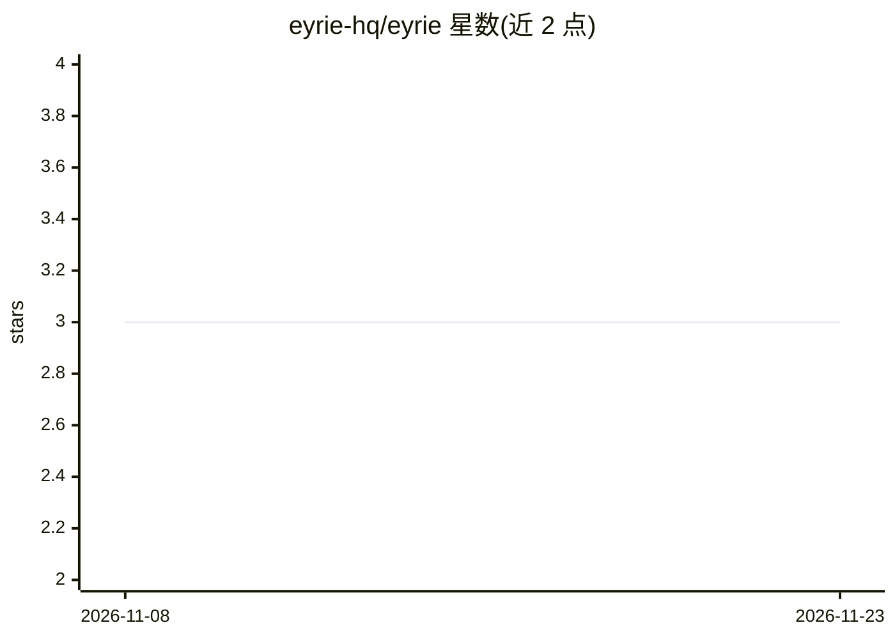

# eyrie-hq/eyrie

⭐ 3 · TypeScript · AGPL-3.0 · 推送 2026-11-04 · [GitHub](https://github.com/eyrie-hq/eyrie) · [官网](https://www.badhansen.com/eyrie) · 组织维护

**把代码库变成随保存实时更新的架构地图，供开发者与编码 agent 使用**

本地解析仓库，构建代码知识图并推导出页面→API 路由→服务→数据→外部服务的架构图，以交互地图呈现；文件保存时只重算受影响的子图并将变更动画显示，同时记录变更带。桌面应用支持 macOS/Windows/Linux，也可从源码以 Node.js 22.13+ 与 pnpm 运行。通过单条 `eyrie` 命令经 MCP 向编码 agent（Claude Code、Codex、Gemini CLI、Cursor 等）提供图谱查询工具；可选开启由 Claude/Codex/Muse/OpenAI 后端生成提交注释与问答，默认关闭。目前仅支持 TS/JS、Python、Go、Java、C#、PHP、Ruby、Rust 项目，JS 支持最深；构建未经 Apple/Microsoft 签名。

## 筛选速览

| 维度 | 判定 | 备注 |
|---|---|---|
| AI 角色 | `ai-enhanced` | 去掉 AI 部分产品仍成立 |
| 许可风险 | `viral` | AGPL-3.0 |
| 部署形态 | `desktop` | 安装包/桌面程序 |
| 模型依赖 | — | README 未给出锁定关系 |
| 硬件要求 | — | 无带数字的原话,不猜 |
| 安装摩擦 | `low` | 无编译、无系统依赖或容器化 |
| 成熟度 | `idea` | |

## 能力要点

- 保存文件后实时增量重算架构图并以动画呈现变更
- 经 MCP 向编码 agent 提供 ask/impact/trace/check 等 11 个图谱查询工具
- 可选 AI 后端生成提交注释，注释须引用实际改动的文件或组件否则被拒绝
- 发布附带 SHA-256 校验与 GitHub attestation 验证

## 适用场景

- 让团队随代码演进查看实时架构依赖图
- 让编码 agent 编辑前查询组件归属与影响面、编辑后核对改动
- 审查提交是否与提交信息一致并标记架构风险

## 场景标签

 · 领域:开发者工具/软件架构

## 证据(README 行号)

> L6: **A live architecture map of your codebase that updates as you (or your coding agent) change the code.**
> L10: > Status: early. Phase 1 (static architecture map) and Phase 2 (live graph) work end to end for TypeScript/JavaScri
> L100: **Eyrie is one command, not a separate server.** `eyrie [path]` indexes a repository and opens its live map; `eyri

## 星数曲线

2026-11-08 3 → 2026-11-23 3（+0）

---
*卡片 v1 · prompt 1.4 · 生成 2026-11-22 · 置信度 mid · 依据 README sha `0fca9a7b5621` · [字段定义](../../DATASET.md)*
