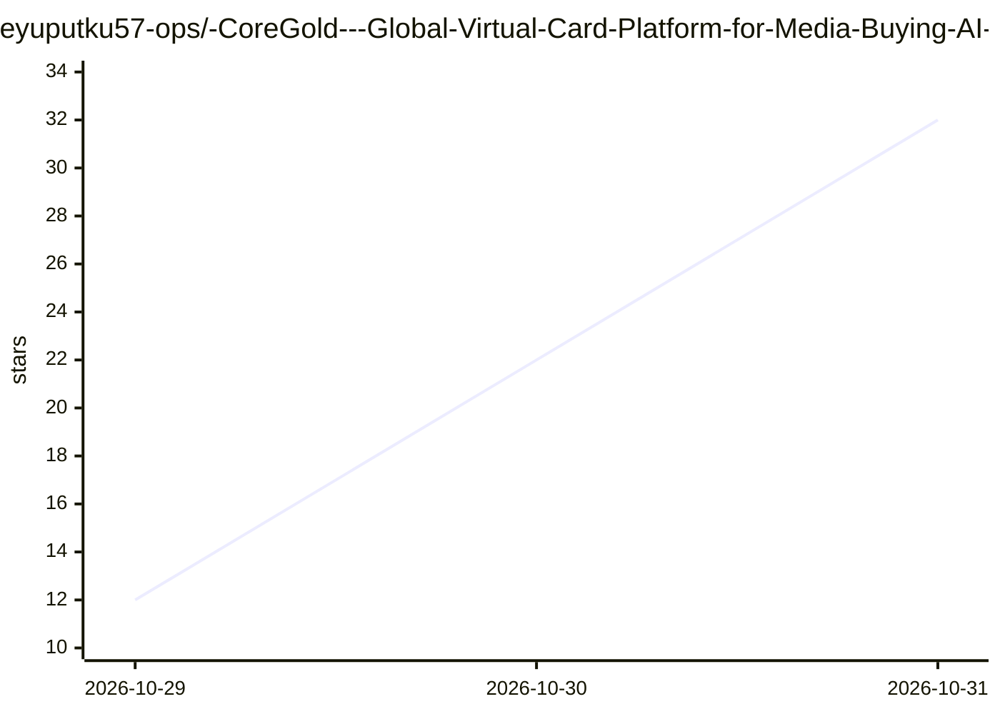

# eyuputku57-ops/-CoreGold---Global-Virtual-Card-Platform-for-Media-Buying-AI-SaaS-Cross-Border-Payments

⭐ 32 · 推送 2026-10-28 · [GitHub](https://github.com/eyuputku57-ops/-CoreGold---Global-Virtual-Card-Platform-for-Media-Buying-AI-SaaS-Cross-Border-Payments) · [官网](https://app.coregold.io/signup?invite_code=ADvlj9b) · 组织维护 · 中文 README

**面向出海团队的 Visa/Mastercard 虚拟卡服务：USDT 充值开卡、多卡隔离**

商业虚拟信用卡（VCC）服务的宣传页面仓库，非开源软件代码：提供 USDT 链上充值、批量创建独立 16 位卡号虚拟卡、单商户锁定、单笔/月度限额与一次性自动销毁卡片、团队协同与交易报表等功能。目标用户为跨境电商卖家、海外广告投放人员与订阅海外 AI/SaaS 工具（ChatGPT Plus、Claude Pro 等）的团队。使用方式为官网注册—USDT 充值—控制台生成卡片，无本地安装或部署内容。

## 筛选速览

| 维度 | 判定 | 备注 |
|---|---|---|
| AI 角色 | `ai-enhanced` | 去掉 AI 部分产品仍成立 |
| 许可风险 | `none` | — |
| 部署形态 | `None` |  |
| 模型依赖 | — | README 未给出锁定关系 |
| 硬件要求 | — | 无带数字的原话,不猜 |
| 安装摩擦 | `low` | 无编译、无系统依赖或容器化 |
| 成熟度 | — | 结构信号不足 |

## 能力要点

- USDT 链上充值实时结算为美元额度
- 批量创建独立卡号虚拟卡，支持单商户锁定与消费限额
- 一次性自动过期卡片用于订阅试用场景
- 多成员协同的卡管理、交易日志与扣费提醒

## 适用场景

- 为 Facebook/TikTok/Google 广告账户提供隔离的支付卡
- 订阅 ChatGPT Plus、Claude Pro 等海外 AI/SaaS 服务
- 云服务账单设置硬性预算上限防止超支

## 场景标签

 · 领域:跨境支付/金融服务

## 证据(README 行号)

> L11: **CoreGold** 深度整合全球优质银行 BIN 资源与 Visa / Mastercard 主流支付网络，提供无限开卡、多卡隔离、单商户绑定与自定义额度管理功能，帮助出海卖家与媒介投放人员搭建稳定、合规、零后顾之忧的支付底
> L28: |**AI 工具与海外 SaaS**|`ChatGPT Plus`, `Claude Pro`, `Cursor`, `Midjourney`, `GitHub Copilot`|完美绕过区域发卡行风控检测，秒级绑卡开通付费订阅|

## 星数曲线

2026-10-29 12 → 2026-10-31 32（+20）

---
*卡片 v1 · prompt 1.4 · 生成 2026-10-30 · 置信度 high · 依据 README sha `b80498c2d560` · [字段定义](../../DATASET.md)*
