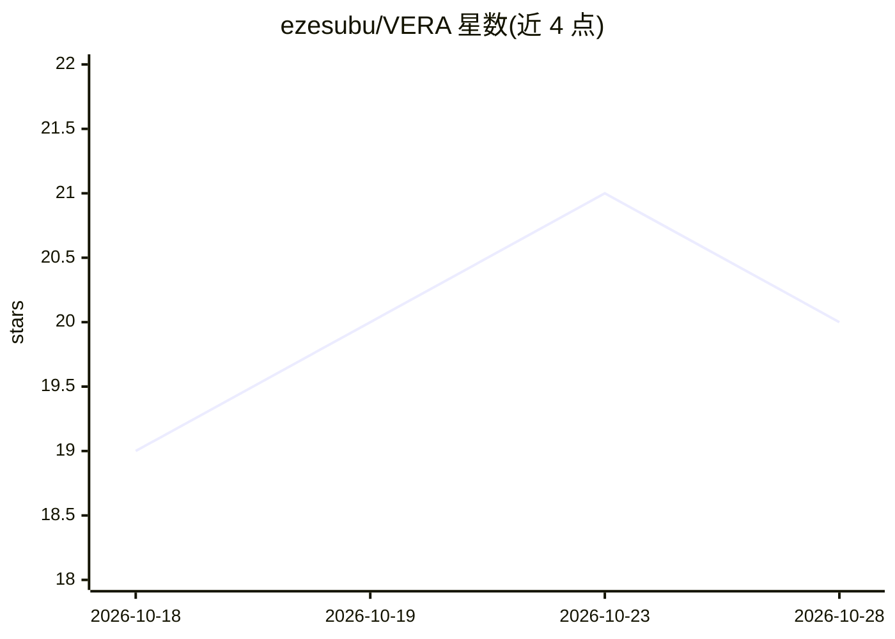

# ezesubu/VERA

⭐ 21 · Python · MIT · 推送 2026-08-10 · [GitHub](https://github.com/ezesubu/VERA) · [官网](https://www.patreon.com/maVERAick) · 个人维护

**给 Unreal 开发者的编辑器内 AI Agent 副驾驶**

Unreal Engine 编辑器内运行的 AI Agent 插件：用自然语言下达指令，Agent 规划、调用编辑器工具、捕获视口图像进行视觉推理并自我纠错验证。支持 8 家 LLM 提供商及任意 OpenAI 兼容本地服务器（LM Studio/Ollama/llama.cpp/vLLM），可完全离线运行。内置关卡检查、动画重定向管线、UE Python 执行等工具，能力以 opt-in 插件形式扩展（tools/ + SKILL.md）。另提供 MCP 服务器，让 Claude Code/Cursor 等 IDE Agent 驱动编辑器。要求 UE 5.7/5.8 与 Python Editor Script Plugin，从源码打包安装。破坏性操作默认需人工确认。

## 筛选速览

| 维度 | 判定 | 备注 |
|---|---|---|
| AI 角色 | `ai-native` | 本体是模型或模型工具 |
| 许可风险 | `permissive` | MIT |
| 部署形态 | `desktop` | 安装包/桌面程序 |
| 模型依赖 | local-ok | 支持本地模型 |
| 硬件要求 | — | 无带数字的原话,不猜 |
| 安装摩擦 | `low` | 无编译、无系统依赖或容器化 |
| 成熟度 | — | 结构信号不足 |

## 能力要点

- 多提供商支持（OpenAI/Anthropic/Gemini/DeepSeek/Groq/HF/NVIDIA NIM/本地服务器），会话中可切换
- 视口截图视觉推理（SceneCapture2D，编辑器最小化也可用）
- 插件式能力扩展（tools/ + SKILL.md），MCP 服务器供外部 IDE Agent 驱动编辑器
- Ask/Auto/Read 三种安全模式，破坏性操作需确认

## 适用场景

- 在 Unreal 编辑器里用自然语言创建 Blueprint、生成 PCG 环境
- 从聊天驱动 rig → retarget → animate → 视觉验证的动画管线
- 让 Claude Code/Cursor 等 IDE Agent 通过 MCP 远程操作 Unreal 编辑器

## 场景标签

`GUI 自动化` · 领域:效率与自动化

## 证据(README 行号)

> L5: **An AI co-pilot that lives inside the Unreal Editor.**
> L24: Most "AI for Unreal" tools are a chat box that hands you a snippet to paste. VERA is
> L46: |🧠 **Multi-provider brain**|OpenAI · Anthropic · Gemini · DeepSeek · Groq · Hugging Face · NVIDIA NIM · any local O

## 星数曲线

2026-10-18 19 → 2026-10-28 20（+1）

---
*卡片 v1 · prompt 1.4 · 生成 2026-10-28 · 置信度 mid · 依据 README sha `5297eb7e1e7a` · [字段定义](../../DATASET.md)*
