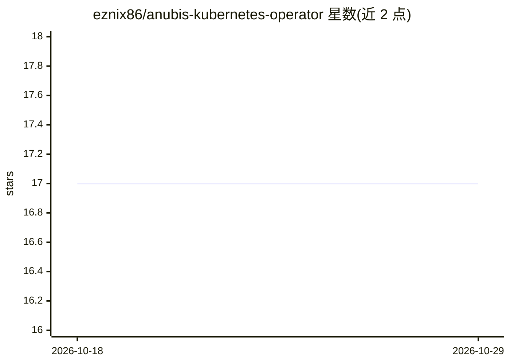

# eznix86/anubis-kubernetes-operator

⭐ 17 · Makefile · MIT · 推送 2026-10-20 · [GitHub](https://github.com/eznix86/anubis-kubernetes-operator) · 个人维护

**在 Kubernetes 上管理 Anubis 防火墙代理的 Operator**

基于 Kubernetes Operator 模式的控制器：通过 AnubisProxy 自定义资源部署和管理 Techaro Anubis 防火墙的反向代理实例，用于保护应用。支持两种模式：proxy（默认，Anubis 作为反向代理）与 forwardAuth（Traefik forwardauth 中间件，Anubis 按请求被咨询但不进入响应数据路径，且 Traefik 是该模式唯一支持的 ingress）。安装为 kubectl apply 官方 install.yaml 清单，自动生成 Middleware 与 IngressRoute，Anubis 运行时版本可通过 spec.anubis.image.tag 固定。仓库主题标签含 ai/anubis/firewall，代码采用 MIT 许可。

## 筛选速览

| 维度 | 判定 | 备注 |
|---|---|---|
| AI 角色 | `ai-ecosystem` | LLM/agent 周边工具 |
| 许可风险 | `permissive` | MIT |
| 部署形态 | `None` |  |
| 模型依赖 | — | README 未给出锁定关系 |
| 硬件要求 | — | 无带数字的原话,不猜 |
| 安装摩擦 | `low` | 无编译、无系统依赖或容器化 |
| 成熟度 | — | 结构信号不足 |

## 能力要点

- 通过 AnubisProxy CRD 在 Kubernetes 中声明式管理 Anubis 防火墙代理
- proxy 与 Traefik forwardAuth 两种运行模式
- forwardAuth 模式自动生成 Traefik Middleware 与 IngressRoute，支持 www 重定向
- kubectl apply 单清单完成安装/升级/卸载

## 适用场景

- 在 Kubernetes 集群中为应用部署 Anubis 防火墙代理
- 通过 Traefik forwardauth 中间件按请求调用 Anubis 鉴权
- 声明式管理多个应用的 Anubis 代理实例

## 场景标签

 · 领域:云原生/网络安全运维

## 证据(README 行号)

> L5: Kubernetes operator for managing Anubis Firewall proxies with the `AnubisProxy` custom resource.
> L46: The operator supports two operating modes: **proxy** (default, Anubis as a reverse proxy) and **forwardAuth** (Trae

## 星数曲线

2026-10-18 17 → 2026-10-29 17（+0）

---
*卡片 v1 · prompt 1.4 · 生成 2026-10-29 · 置信度 mid · 依据 README sha `3b2c67161bc5` · [字段定义](../../DATASET.md)*
