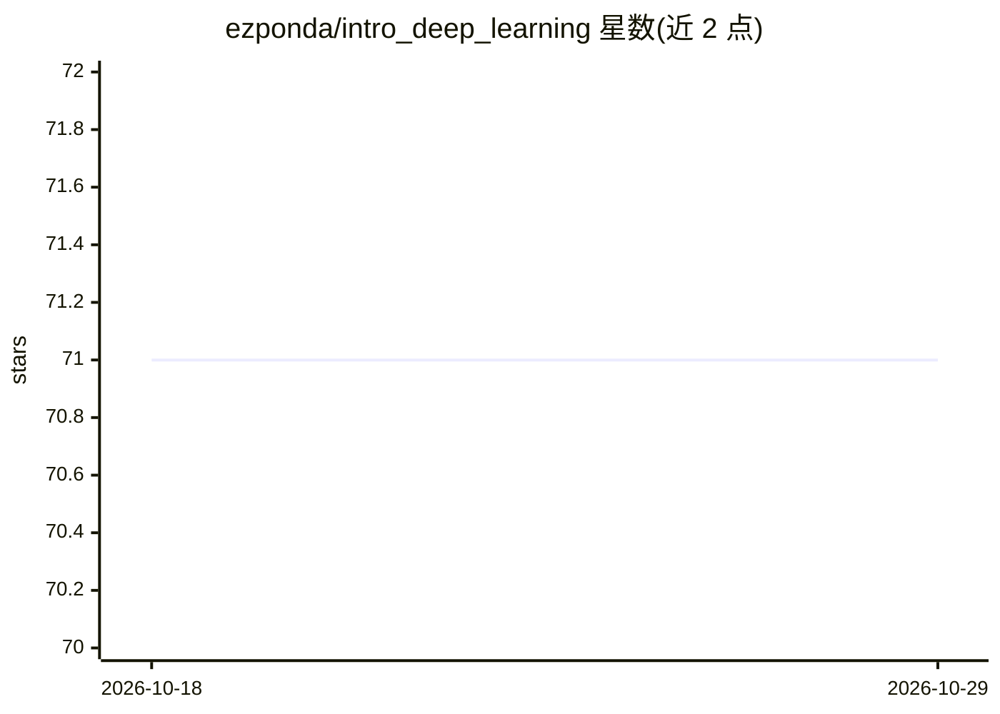

# ezponda/intro_deep_learning

⭐ 71 · Jupyter Notebook · 推送 2026-07-05 · [GitHub](https://github.com/ezponda/intro_deep_learning) · 个人维护

**深度学习实战课程仓库：四模块 Jupyter 教学笔记本**

实践深度学习课程的配套仓库，提供覆盖基础、CNN、RNN、NLP 四个模块的 Jupyter 笔记本，将理论、代码与讲解合并在同一文档中。内容包括 MNIST 分类、经典 CNN 架构、YOLO 目标检测、OCR、CLIP 零样本分类、SegFormer 分割、RNN 时序预测与文本生成、语义搜索等。笔记本可在本地（pip 安装依赖）、Google Colab 或 Docker 容器中运行，附 TensorFlow 理论回顾文档。

## 筛选速览

| 维度 | 判定 | 备注 |
|---|---|---|
| AI 角色 | `ai-knowledge` | 知识聚合/清单类 |
| 许可风险 | `none` | — |
| 部署形态 | `self-host` | docker 或自建部署 |
| 模型依赖 | — | README 未给出锁定关系 |
| 硬件要求 | — | 无带数字的原话,不猜 |
| 安装摩擦 | `low` | 无编译、无系统依赖或容器化 |
| 成熟度 | — | 结构信号不足 |

## 能力要点

- 四模块结构：基础/CNN/RNN/NLP，每模块含多个可运行笔记本
- 覆盖目标检测（YOLO/Ultralytics）、OCR（Tesseract/EasyOCR/TrOCR）、CLIP 零样本分类等主题
- 提供本地 pip、Google Colab、Docker 三种运行方式
- 含 TensorFlow 深度学习概念回顾笔记本

## 适用场景

- 系统学习深度学习理论与实践代码
- 查找目标检测、OCR、语义搜索等具体任务的示例笔记本
- 在 Colab 或 Docker 环境中免配置复现课程代码

## 场景标签

`教程课程` · 领域:学习与行业

## 证据(README 行号)

> L9: The content in this repository is divided into five key modules, focusing on various aspects of **Deep Learning**. E
> L11: - **Module 1: Deep Learning Fundamentals**: `class/Fundamentals`

## 星数曲线

2026-10-18 71 → 2026-10-29 71（+0）

---
*卡片 v1 · prompt 1.4 · 生成 2026-10-24 · 置信度 high · 依据 README sha `9c606fc9356e` · [字段定义](../../DATASET.md)*
