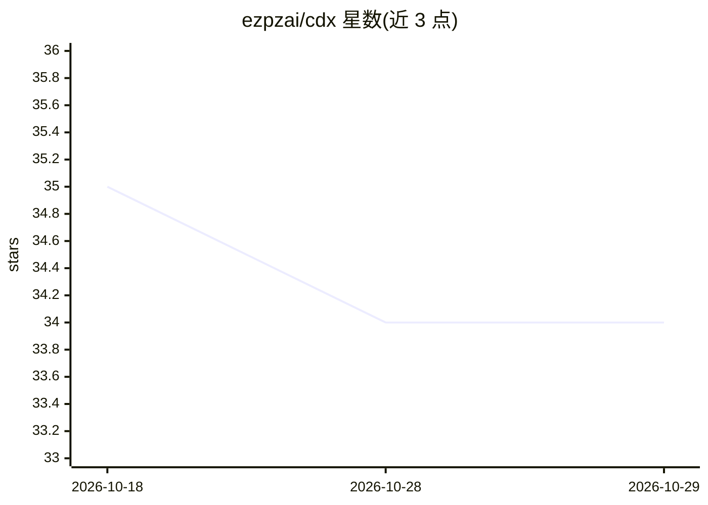

# ezpzai/cdx

⭐ 34 · JavaScript · Apache-2.0 · 推送 2026-06-22 · [GitHub](https://github.com/ezpzai/cdx) · 组织维护 · 中文 README

**多档案管理与手机远程接入 Codex 的 CLI 工具**

围绕 OpenAI Codex CLI 的配置与使用工具：为 Codex 创建多个 profile 并各自维护 CODEX_HOME 与会话存储，提供 safe/balanced/yolo 运行模式、用量查询、AGENTS.md 全局配置管理。通过 Cloudflare Quick Tunnel 或 LAN 将桌面 Codex 会话暴露为手机可访问的 Web 界面。要求 Node.js 20+、已安装 Codex 与 cloudflared，支持 Linux 与 macOS，以 npm 全局安装。

## 筛选速览

| 维度 | 判定 | 备注 |
|---|---|---|
| AI 角色 | `ai-ecosystem` | LLM/agent 周边工具 |
| 许可风险 | `permissive` | Apache-2.0 |
| 部署形态 | `library` | 以包/库形式分发 |
| 模型依赖 | — | README 未给出锁定关系 |
| 硬件要求 | — | 无带数字的原话,不猜 |
| 安装摩擦 | `low` | 无编译、无系统依赖或容器化 |
| 成熟度 | — | 结构信号不足 |

## 能力要点

- 多 profile 管理 Codex 登录、会话与 CODEX_HOME
- cdx remote 经 Cloudflare Quick Tunnel/LAN 从手机继续桌面会话
- safe/balanced/yolo 三档运行模式与用量/配额查询

## 适用场景

- 在一台机器上切换多个 Codex 账号/配置
- 在外面用手机继续操控桌面上的 Codex 会话
- 集中管理全局 AGENTS.md 与会话存储方式

## 场景标签

 · 领域:开发者工具/CLI

## 证据(README 行号)

> L9: **Use Codex more easily, even from mobile.**
> L18: - Codex installed: `npm install -g @openai/codex`
> L66: |`cdx remote [profile] [codex args...] [--mode <safe\|balanced\|yolo>] [--tunnel <cloudflare\|none>] [--no-qr] [--l

## 星数曲线

2026-10-18 35 → 2026-10-29 34（-1）

---
*卡片 v1 · prompt 1.4 · 生成 2026-10-25 · 置信度 high · 依据 README sha `b42260aaffeb` · [字段定义](../../DATASET.md)*
