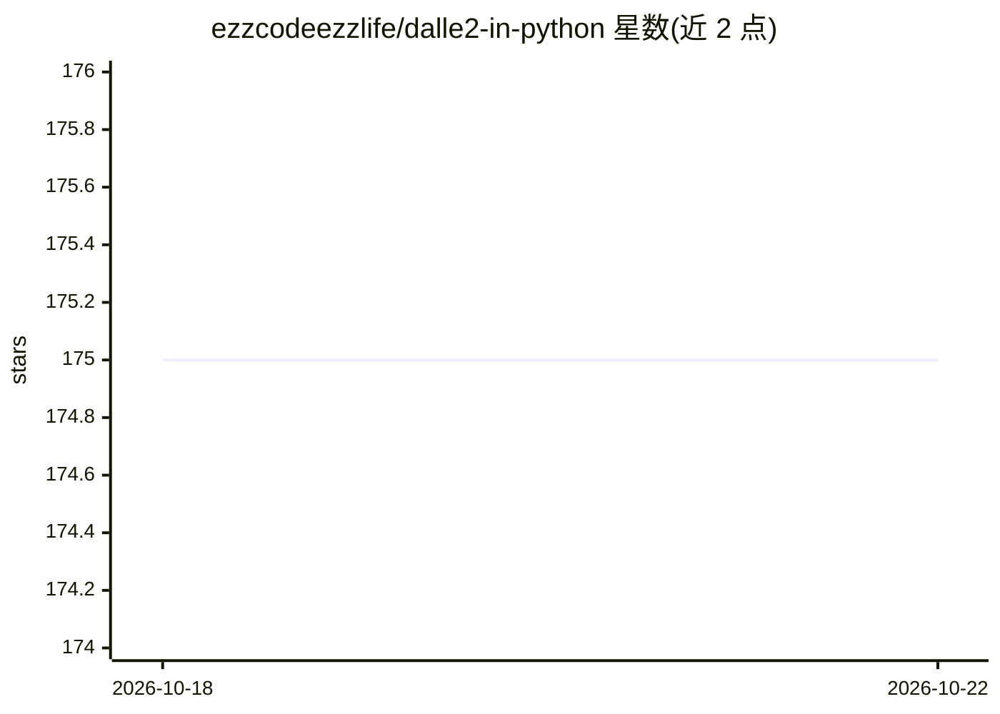

# ezzcodeezzlife/dalle2-in-python

⭐ 175 · Python · MIT · 推送 2025-11-19 · [GitHub](https://github.com/ezzcodeezzlife/dalle2-in-python) · [官网](https://pypi.org/project/dalle2/) · 个人维护

**在 Python 中调用 DALL·E 2 网页接口生成图像的客户端库**

Python 包，通过从 labs.openai.com 抓取的 Bearer Token 调用 DALL·E 2 网页任务接口，提供生成图像、生成并下载、指定数量批量生成（每批 4 张）与基于透明区域的 inpainting 填充等函数，返回任务 ID 并轮询完成状态。面向希望在 Python 脚本中集成 DALL·E 2 生成的开发者。README 首行声明 OpenAI 已有官方 API，且 Token 需从浏览器开发者工具手动提取，属非官方接入方式。

## 筛选速览

| 维度 | 判定 | 备注 |
|---|---|---|
| AI 角色 | `ai-ecosystem` | LLM/agent 周边工具 |
| 许可风险 | `permissive` | MIT |
| 部署形态 | `library` | 以包/库形式分发 |
| 模型依赖 | — | README 未给出锁定关系 |
| 硬件要求 | — | 无带数字的原话,不猜 |
| 安装摩擦 | `low` | 无编译、无系统依赖或容器化 |
| 成熟度 | — | 结构信号不足 |

## 能力要点

- generate / generate_and_download / generate_amount 生成与下载接口
- 支持批量生成（批次大小为 4）
- 支持 inpainting：填充图像透明区域
- 通过 Bearer Token 调用 labs.openai.com 任务接口

## 适用场景

- 在 Python 脚本中用 DALL·E 2 生成图像并下载
- 批量生成多张图像（4 的倍数）
- 对已有图像做透明区域 inpainting 填充

## 场景标签

 · 领域:图像生成/开发库

## 证据(README 行号)

> L16: 6. Look for fetch to https://labs.openai.com/api/labs/tasks
> L21: dalle = Dalle2("sess-xxxxxxxxxxxxxxxxxxxxxxxxxxxx") # your bearer key

## 星数曲线

2026-10-18 175 → 2026-10-22 175（+0）

---
*卡片 v1 · prompt 1.4 · 生成 2026-10-22 · 置信度 high · 依据 README sha `cad685e300af` · [字段定义](../../DATASET.md)*
