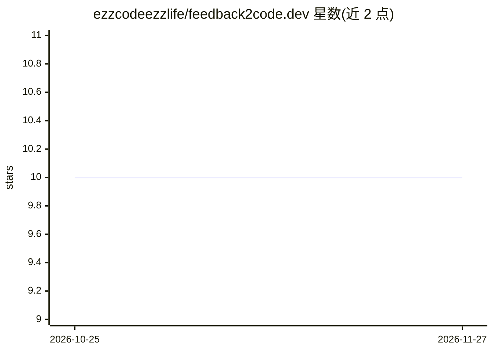

# ezzcodeezzlife/feedback2code.dev

⭐ 10 · TypeScript · NOASSERTION · 推送 2026-08-18 · [GitHub](https://github.com/ezzcodeezzlife/feedback2code.dev) · [官网](feedback2code.dev) · 个人维护

**帮机构/自由职业者把客户反馈自动转为 GitHub PR**

面向维护客户网站的机构与自由职业者的反馈自动化产品：在客户站点嵌入一行 script 的聊天挂件，客户用自然语言描述修改需求后，系统调度 E2B 沙盒 VM 克隆目标仓库，由 OpenCode 与 MiniMax-M3 驱动的 coding agent 在沙盒内实现改动，并通过 GitHub App 机器人开 Pull Request，合并与否由用户决定。本仓库为产品源码，仅作参考展示，明确声明不可自部署、非开源，使用须走其云版本。

## 筛选速览

| 维度 | 判定 | 备注 |
|---|---|---|
| AI 角色 | `ai-native` | 本体是模型或模型工具 |
| 许可风险 | `none` | NOASSERTION |
| 部署形态 | `self-host` | docker 或自建部署 |
| 模型依赖 | — | README 未给出锁定关系 |
| 硬件要求 | — | 无带数字的原话,不猜 |
| 安装摩擦 | `low` | 无编译、无系统依赖或容器化 |
| 成熟度 | — | 结构信号不足 |

## 能力要点

- 一行 script 标签嵌入，无框架与构建步骤依赖
- E2B 隔离沙盒内运行 agent，GitHub 凭证以短时效令牌注入并在运行前清除
- 产出为 Pull Request，不直接推送到生产环境
- 支持公开与私有 GitHub 仓库

## 适用场景

- 客户在live站点上直接描述“按钮改色”类需求并自动成 PR
- 自由职业者用审阅 diff 替代解读客户邮件
- 给 SaaS、文档站或内部工具接入站点内反馈转代码流程

## 场景标签

`编码 Agent` `聊天机器人` · 领域:编码与开发

## 证据(README 行号)

> L43: the change in their own words. An isolated coding agent clones the repo,
> L53: 3. **Agent.** OpenCode with **MiniMax-M3** implements the request inside the VM.

## 星数曲线

2026-10-25 10 → 2026-11-27 10（+0）

---
*卡片 v1 · prompt 1.4 · 生成 2026-11-19 · 置信度 mid · 依据 README sha `1e9a431a8a77` · [字段定义](../../DATASET.md)*
