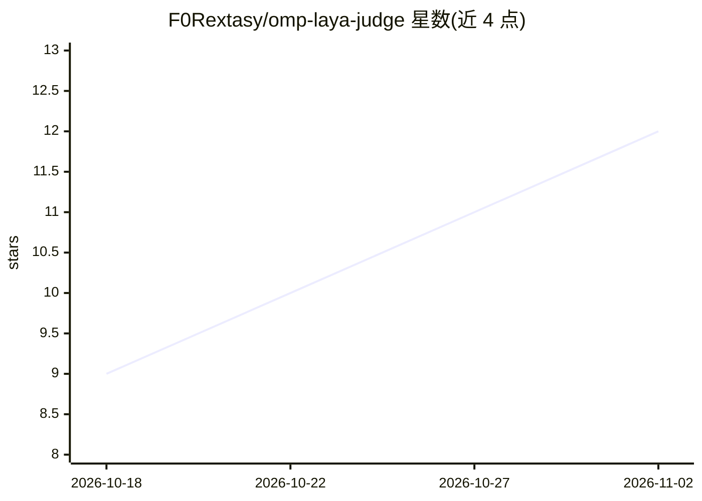

# F0Rextasy/omp-laya-judge

⭐ 12 · HTML · NOASSERTION · 推送 2026-09-26 · [GitHub](https://github.com/F0Rextasy/omp-laya-judge) · 个人维护

**oh-my-pi 的本地 System-1 判决 MCP 服务器：毫秒级类型化决策**

面向 oh-my-pi agent 框架的 MCP 插件与技能：以 laya 为后端在本地 CPU 上输出 choice/bool/score 三类类型化判决（均值约 402ms，不消耗 LLM token），带 0.6 置信门控（低于阈值升级到 LLM）与精确算术解析器。以 HTTP 边车形式运行，暴露 mcp__laya-judge__judge 工具，可作为 harness 的原生判决后端（占用 TypeSafe jev / OpenRouter Decisions 的同一槽位），并在会话事件点通过 hook 主动判决（fail-open）。限制：英文检查点，非英文（如土耳其语）正确率为 0/7；宽批次本地延迟高于单次远程调用。

## 筛选速览

| 维度 | 判定 | 备注 |
|---|---|---|
| AI 角色 | `ai-ecosystem` | LLM/agent 周边工具 |
| 许可风险 | `none` | NOASSERTION |
| 部署形态 | `desktop` | 安装包/桌面程序 |
| 模型依赖 | — | README 未给出锁定关系 |
| 硬件要求 | — | 无带数字的原话,不猜 |
| 安装摩擦 | `low` | 无编译、无系统依赖或容器化 |
| 成熟度 | — | 结构信号不足 |

## 能力要点

- choice/bool/score 三类类型化判决，CPU 上均值约 402ms、0 LLM token
- 0.6 置信门控：低置信升级到 LLM，12 例基准中 false-accept 为 0%
- 可作为 harness 原生 System One 判决后端（jev/Decisions 同槽位），后端可经环境变量切换
- hooks 在会话事件点主动请求判决，全部 fail-open

## 适用场景

- 让 agent 框架的判断类调用走本地零 token 通道，降低延迟与成本
- 在判卷/路由/分诊等类型化决策场景替代远程 LLM 调用
- 查看每回合本地判决的来源与延迟（决策环形缓冲与回合卡片）

## 场景标签

`Agent 框架` · 领域:Agent 开发

## 证据(README 行号)

> L190: The plugin exposes `mcp__laya-judge__judge(state, questions)` plus the
> L218: oh-my-pi resolves typed judgments through a `judge` role chain. A candidate
> L221: that wire protocol (`state` + `noul`/`choice`/`score` → typed `answers`), so

## 星数曲线

2026-10-18 9 → 2026-11-02 12（+3）

---
*卡片 v1 · prompt 1.4 · 生成 2026-11-02 · 置信度 high · 依据 README sha `8353fc931f08` · [字段定义](../../DATASET.md)*
