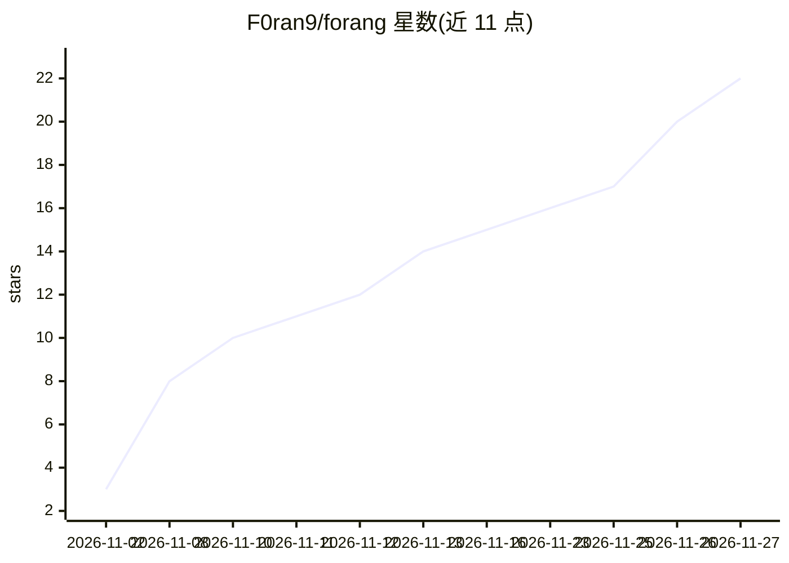

# F0ran9/forang

⭐ 22 · Go · AGPL-3.0 · 推送 2026-11-26 · [GitHub](https://github.com/F0ran9/forang) · 个人维护 · 中文 README

**多 Agent 协同的 AI 自动化渗透测试平台，覆盖侦察到 C2 全链路**

面向授权安全测试（渗透测试/护网/SRC/CTF）的 AI 自动化平台：planner/worker/supervisor 多 Agent 协同驱动 40+ 工具执行侦察、漏洞发现、利用拿权、Webshell 落地与 C2 控制全链路，攻击动作写入持久化链路图并生成 Word/Markdown 取证报告。Webshell 管理器兼容蚁剑/冰蝎/哥斯拉三协议，C2 指挥台对标 Cobalt Strike 作业习惯。内置规则拦截 + LLM 裁判审批 + 人工审批三档管控与审计防篡改。Go 单二进制（内嵌 Next.js 前端）+ PostgreSQL，Docker Compose 部署；LLM 需自行配置（兼容 OpenAI/Anthropic 协议）。基于 ARTEX（AGPL-3.0）二次开发。

## 筛选速览

| 维度 | 判定 | 备注 |
|---|---|---|
| AI 角色 | `ai-native` | 本体是模型或模型工具 |
| 许可风险 | `viral` | AGPL-3.0 |
| 部署形态 | `self-host` | docker 或自建部署 |
| 模型依赖 | — | README 未给出锁定关系 |
| 硬件要求 | — | 无带数字的原话,不猜 |
| 安装摩擦 | `low` | 无编译、无系统依赖或容器化 |
| 成熟度 | — | 结构信号不足 |

## 能力要点

- planner/worker/supervisor 多 Agent 协同驱动侦察→漏洞→拿权→C2 全链路，动作入图留痕
- Webshell 管理器字节级兼容蚁剑/冰蝎/哥斯拉三协议，含三级免杀生成
- 源码静态审计：上传 zip 后 AI 多 Agent 只读分析，漏洞带文件行号证据
- AI 审批监管：规则引擎 + LLM 裁判（fail-closed）+ 人工审批队列

## 适用场景

- 授权渗透测试中自动化完成侦察到报告的全流程
- 上传源码包做不出网的静态安全审计
- 红队作业中用 C2 指挥台与 Webshell 管理器管理会话
- 批量资产导入后并发指纹识别并生成独立 AI 渗透任务

## 场景标签

`多智能体` `网络安全` · 领域:Agent 开发

## 证据(README 行号)

> L11: **多 Agent 协同的 AI 自动化渗透平台**：planner 拆解目标、worker 驱动 40+ 工具真实进攻、监督员实时纠偏，在授权边界内自动完成 **侦察 → 漏洞发现 → 利用拿权 → Webshell 落地 → 
> L19: - 🧠 **LLM 是渗透引擎，不是聊天窗口** — planner / worker / supervisor 多 Agent 协同：目标自动拆解为意图链，worker 领取意图驱动真实工具进攻，探索链路图（目标→意图→事实→漏
> L24: - 🛡️ **AI 审批监管：AI 管 AI** — 未命中规则的工具调用交由**裁判小模型**实时审查（D1-D6 破坏判据 / A1-A6 放行判据 / 判不准转人工），judge 失败 fail-closed；监督员定时巡视

## 星数曲线

2026-11-02 3 → 2026-11-27 22（+19）

---
*卡片 v1 · prompt 1.4 · 生成 2026-11-18 · 置信度 mid · 依据 README sha `38e8ba071155` · [字段定义](../../DATASET.md)*
