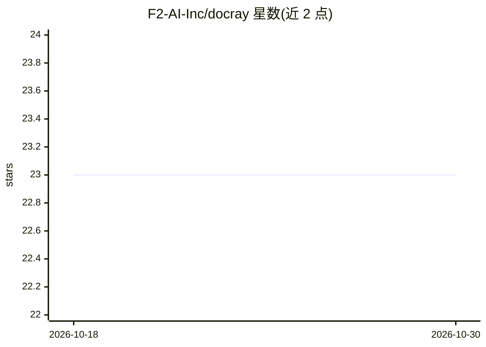

# F2-AI-Inc/docray

⭐ 23 · HTML · Apache-2.0 · 推送 2026-10-28 · [GitHub](https://github.com/F2-AI-Inc/docray) · [官网](https://f2-ai-inc.github.io/docray/try/) · 组织维护

**PDF/PPTX/DOCX 无损解析为带坐标 JSON 的文档抽取工具**

用 Rust 与 PDFium 实现的文档解析工具：从 PDF、PPTX、DOCX/DOCM 中抽取文本（含字体/颜色/层级）、图片、矢量路径与批注，全部附带页面坐标，输出确定性 JSON。PDF 支持 char/word/element 三种粒度，word/element 面向 LLM/RAG 并给出 token 缩减数据；另提供 lean 行式输出格式。以 CLI（docray）与 HTTP 服务（docray-server，含同步端点与异步任务队列）形式提供，并带浏览器 playground。扫描页仅标记 scanned:true，不做 OCR。

## 筛选速览

| 维度 | 判定 | 备注 |
|---|---|---|
| AI 角色 | `ai-ecosystem` | LLM/agent 周边工具 |
| 许可风险 | `permissive` | Apache-2.0 |
| 部署形态 | `desktop` | 安装包/桌面程序 |
| 模型依赖 | — | README 未给出锁定关系 |
| 硬件要求 | — | 无带数字的原话,不猜 |
| 安装摩擦 | `low` | 无编译、无系统依赖或容器化 |
| 成熟度 | — | 结构信号不足 |

## 能力要点

- PDF 三档粒度抽取：char 默认无损，word/element 面向 LLM/RAG，含 token 缩减实测数据
- CLI + HTTP 服务双形态：同步 /v1/extract 与异步任务队列，含浏览器 playground
- lean 行式输出在实测语料上比紧凑 element JSON 少用 26–39% token
- 环境变量全量配置：并发 worker、内存/超时限制、OTLP 指标（兼容 Prometheus/Grafana/Datadog 等）

## 适用场景

- 把 PDF/PPTX/DOCX 转成带边界框的 JSON 供 RAG 管线摄取
- 以 HTTP 服务形式为多客户端提供文档抽取端点
- 按字符级无损归档文档的可溯源坐标信息

## 场景标签

`文档解析` · 领域:知识与检索

## 证据(README 行号)

> L3: docray extracts structured, deterministic JSON (text with font/color/hierarchy,
> L117: LLM/RAG-oriented, one-decimal-point representations: their bbox is
> L163: JSON remains the default and preserves the existing byte contract. For an LLM

## 星数曲线

2026-10-18 23 → 2026-10-30 23（+0）

---
*卡片 v1 · prompt 1.4 · 生成 2026-10-27 · 置信度 high · 依据 README sha `34af24fc52f7` · [字段定义](../../DATASET.md)*
