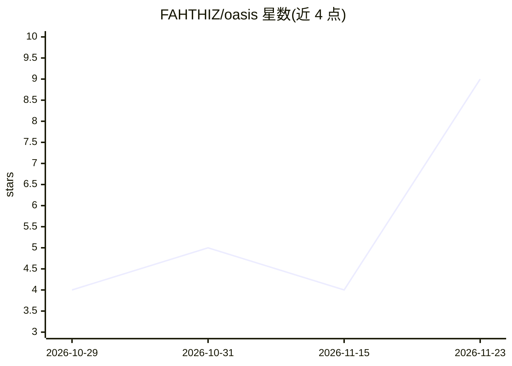

# FAHTHIZ/oasis

⭐ 9 · JavaScript · Apache-2.0 · 推送 2026-11-22 · [GitHub](https://github.com/FAHTHIZ/oasis) · 个人维护

**接任意模型的终端与自托管 Web 编码代理**

OASIS 是一个开源编码代理，提供终端 CLI 与自托管的 Web 应用两种界面，运行在用户自己的机器或服务器上。核心机制是验证门（verification gate）：任务完成前必须实际运行检查并看到输出，否则任务被打回继续。支持接入多家模型服务商与本地模型端点，可直接加载 Claude Code 的 CLAUDE.md、插件、技能等配置，兼容 MCP 服务器，提供子代理、任务看板、检查点回退、权限模式与沙箱等机制。需要 Node.js 22.19+ 与 Git，跨 Windows/macOS/Linux，Apache 2.0 许可。

## 筛选速览

| 维度 | 判定 | 备注 |
|---|---|---|
| AI 角色 | `ai-ecosystem` | LLM/agent 周边工具 |
| 许可风险 | `permissive` | Apache-2.0 |
| 部署形态 | `library` | 以包/库形式分发 |
| 模型依赖 | local-ok | 支持本地模型 |
| 硬件要求 | — | 无带数字的原话,不猜 |
| 安装摩擦 | `low` | 无编译、无系统依赖或容器化 |
| 成熟度 | — | 结构信号不足 |

## 能力要点

- 验证门机制：任务须实际跑过检查才允许报告完成
- 终端、Web 应用、桌面应用、ACP 编辑器、CI 等多种接入方式共用同一运行时
- 直接加载 Claude Code 的配置与插件，Codex/Gemini CLI 扩展安装时转换
- 并行子代理、代理团队共享任务板、检查点回退与跨会话记忆

## 适用场景

- 在终端或浏览器里让代理读代码、改代码并跑测试验证
- 自托管在服务器上，从远程工作站接续正在运行的任务
- 在 CI 工作流或 GitHub Actions 上运行代理任务并开 PR
- 复用现有 Claude Code 插件与配置换用其他模型

## 场景标签

`编码 Agent` · 领域:编码与开发

## 证据(README 行号)

> L53: Ask in plain words: "find out why the login test fails and fix it". OASIS reads the code, edits the files, runs the
> L119: You ask in plain words. OASIS reads the code, makes the edit, then has to pass the verification gate before it may
> L127:  OpenAI, Anthropic, Gemini, Bedrock, Vertex AI, OpenRouter, Groq, DeepSeek, Mistral, xAI, any OpenAI-compatible en

## 星数曲线

2026-10-29 4 → 2026-11-23 9（+5）

---
*卡片 v1 · prompt 1.4 · 生成 2026-11-21 · 置信度 high · 依据 README sha `681fdff6e593` · [字段定义](../../DATASET.md)*
