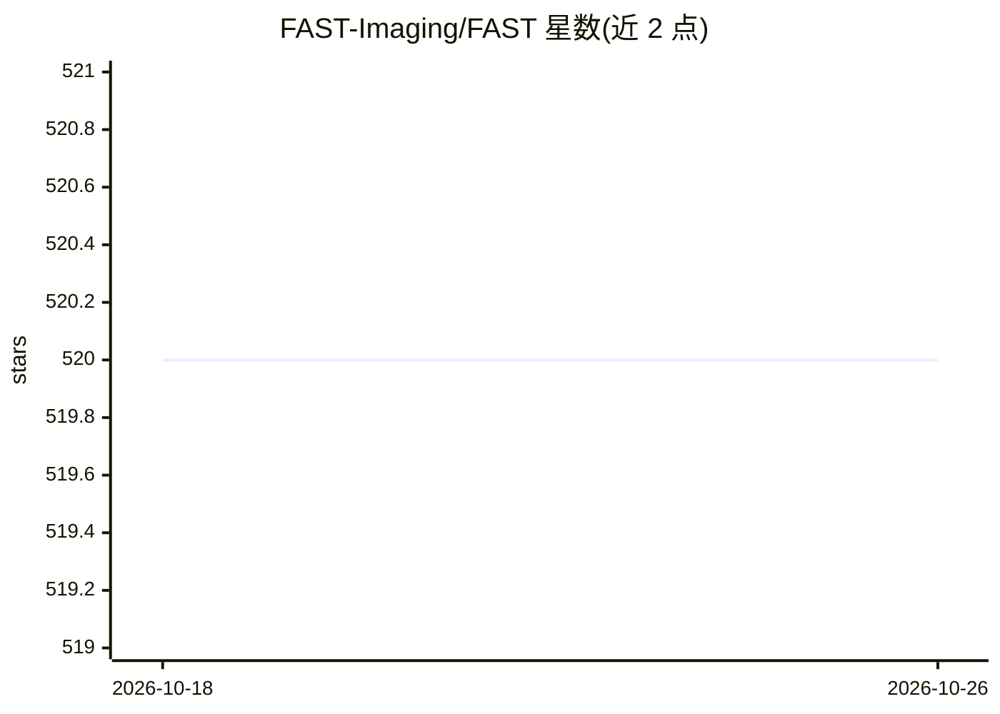

# FAST-Imaging/FAST

⭐ 520 · C++ · BSD-2-Clause · 推送 2026-10-14 · [GitHub](https://github.com/FAST-Imaging/FAST) · [官网](https://fast-imaging.github.io) · 组织维护

**医学图像高性能处理、神经网络推理与可视化框架**

由挪威科技大学（NTNU）与 SINTEF 研究人员开发的开源框架，用 C++/OpenCL/OpenGL 实现多核 CPU 与 GPU 上的医学图像处理、神经网络推理与可视化。提供统一接口支持多种模型格式（ONNX、protobuf、SavedModel、OpenVINO、UFF）与推理后端（TensorFlow、TensorRT、OpenVINO、ONNX Runtime），支持数据流处理（含超声扫描仪直连）、DICOM/NIFTI/全切片图像等多种格式，并提供 Python 接口与 Qt 集成。BSD 2-clause 许可。

## 筛选速览

| 维度 | 判定 | 备注 |
|---|---|---|
| AI 角色 | `ai-ecosystem` | LLM/agent 周边工具 |
| 许可风险 | `permissive` | BSD-2-Clause |
| 部署形态 | `None` |  |
| 模型依赖 | — | README 未给出锁定关系 |
| 硬件要求 | — | 无带数字的原话,不猜 |
| 安装摩擦 | `low` | 无编译、无系统依赖或容器化 |
| 成熟度 | — | 结构信号不足 |

## 能力要点

- 统一接口支持 ONNX/SavedModel/OpenVINO/UFF 等格式与四家推理后端
- 静态与动态数据流管线，可从电影文件、摄像头、超声扫描仪（如 Clarius）直连取流
- 支持 DICOM、NIFTI、MHD、HDF5、全切片图像等多种医学图像格式
- Python 接口，可集成到已有 Qt 应用

## 适用场景

- 构建医学图像的实时神经网络推理与可视化管线
- 处理超声、病理全切片等动态或大规模医学图像数据
- 在 C++ 或 Python 中开发跨 CPU/GPU 的医学图像分析应用

## 场景标签

`图像视频处理` `推理引擎` · 领域:感知与多模态

## 证据(README 行号)

> L6: FAST is an open-source framework developed by researchers at the Norwegian University of Science and Technology (NTN
> L7: The main goal of FAST is to make it easier to do high-performance processing, neural network inference, and visualiz
> L23: * **Deep learning** – FAST provides a common interface for neural networks supporting different model formats (ONNX

## 星数曲线

2026-10-18 520 → 2026-10-26 520（+0）

---
*卡片 v1 · prompt 1.4 · 生成 2026-10-21 · 置信度 high · 依据 README sha `9f85ba6f35cf` · [字段定义](../../DATASET.md)*
