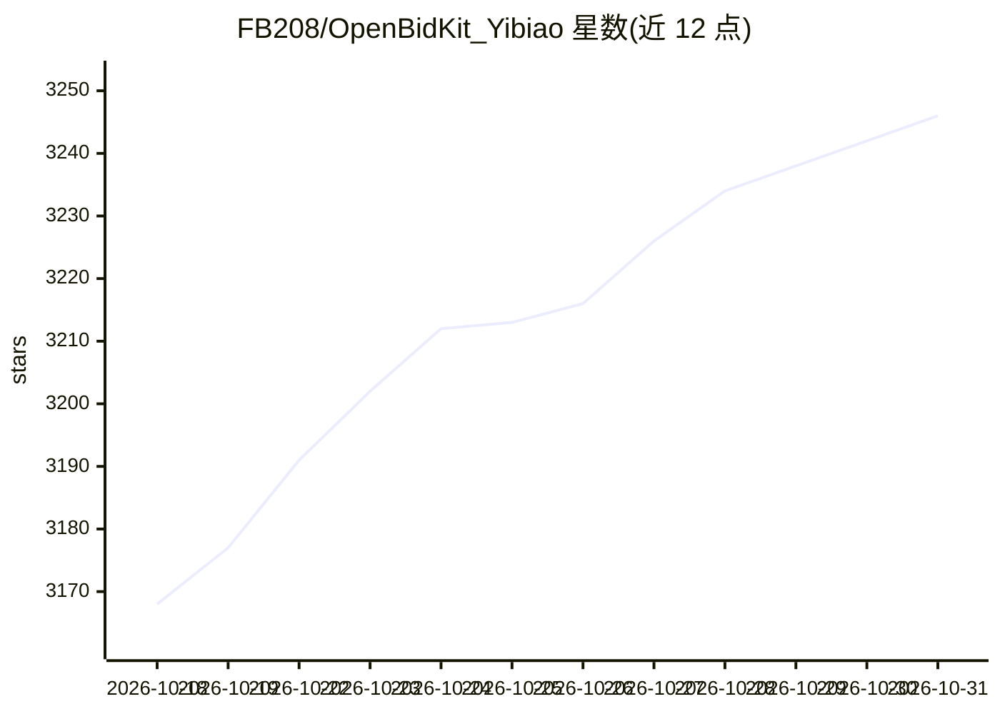

# FB208/OpenBidKit_Yibiao

⭐ 3,246 · JavaScript · AGPL-3.0 · 推送 2026-10-29 · [GitHub](https://github.com/FB208/OpenBidKit_Yibiao) · [官网](https://yibiao.pro) · 个人维护 · 中文 README

**面向招投标场景的开源 AI 标书生成桌面工具**

易标投标工具箱是 Electron + React + TypeScript 构建的桌面应用，面向投标人员提供 AI 生成技术方案、图文生成、商务标编写、招标文件解析（18 个解析项）、企业知识库、多份标书查重、废标项检查、错别字与逻辑谬误分析等能力。支持 OpenAI 兼容 API 及 ollama、LM Studio 本地模型接入；本地保存配置与生成结果，耗时任务后台落盘可恢复。从 GitHub Releases 下载安装包使用，本地开发需 Node.js 22，调试 Open XML 或打包需 .NET 10 SDK。AGPL-3.0 协议，自述 AI 标书仍处初级阶段。

## 筛选速览

| 维度 | 判定 | 备注 |
|---|---|---|
| AI 角色 | `ai-native` | 本体是模型或模型工具 |
| 许可风险 | `viral` | AGPL-3.0 |
| 部署形态 | `None` |  |
| 模型依赖 | local-ok | 支持本地模型 |
| 硬件要求 | — | 无带数字的原话,不猜 |
| 安装摩擦 | `medium` | 含编译或系统依赖之一 |
| 成熟度 | `idea` | |

## 能力要点

- AI 生成标书初稿并支持目录、正文持续编辑定稿
- 本地知识库沉淀企业资料与历史案例
- 标书查重、废标项检查、错别字检查、逻辑谬误分析
- 支持 OpenAI 兼容 API 与 ollama、LM Studio 本地模型

## 适用场景

- 中小企业用 AI 生成投标文件初稿降低编写成本
- 沉淀企业资料和历史标书供后续复用
- 提交前对标书做查重与废标项检查

## 场景标签

`AI 写作` `知识库管理` · 领域:内容生成

## 证据(README 行号)

> L23:  易标投标工具箱是一款面向招投标场景的智能标书制作工具，完全开源，包括AI生成技术方案、图文生成、商务标、企业知识库管理、标书查重、废标项检查、标讯等，更多功能还在开发中。
> L25:  支持OpenAI like模式的所有AI api，也支持ollama、lm studio等接入本地模型。
> L57:  AI写标书 · 标书AI · AI标书生成 · 技术标编写 · 投标文件生成

## 星数曲线

2026-10-18 3,168 → 2026-10-31 3,246（+78）

---
*卡片 v1 · prompt 1.4 · 生成 2026-10-20 · 置信度 high · 依据 README sha `e9a0418105c5` · [字段定义](../../DATASET.md)*
