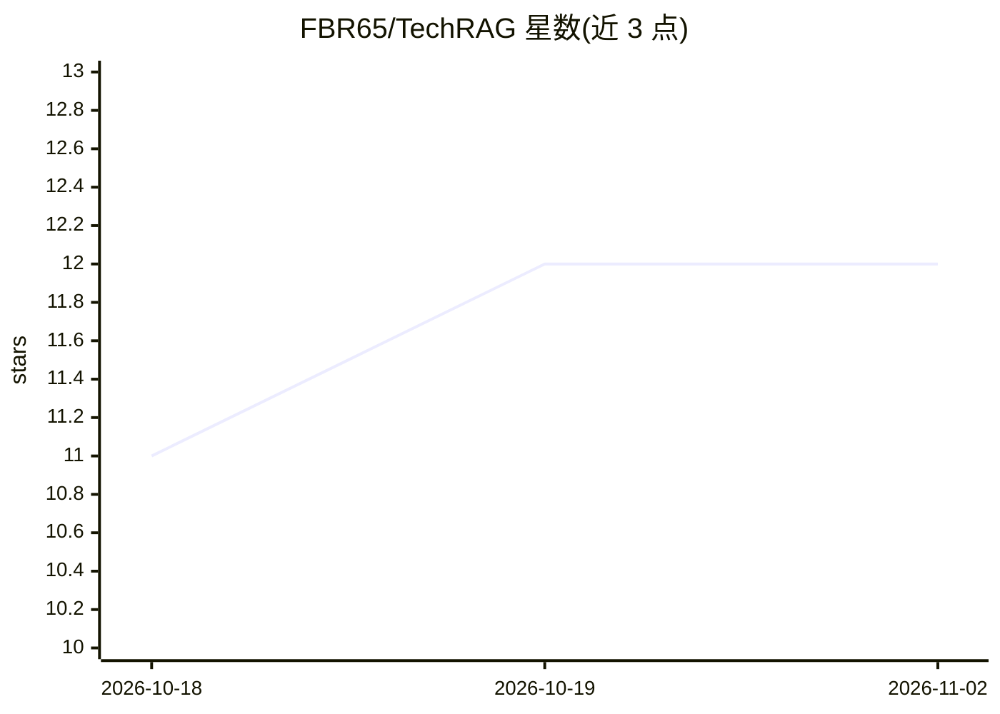

# FBR65/TechRAG

⭐ 12 · Python · MIT · 推送 2026-07-06 · [GitHub](https://github.com/FBR65/TechRAG) · 个人维护

**面向技术文档的本体驱动混合检索 RAG 引擎**

面向技术文档的检索增强生成引擎：摄取时解析 PDF/Markdown/文本，经 OpenAI 兼容嵌入端点写入 LanceDB 向量库，并按 SQLGraph 方式用 SQLAlchemy 构建领域本体与知识图谱，抽取带来源回指的原子事实三元组。查询时结合向量搜索、自适应查询扩展与图上下文生成回答，输出证据覆盖率、推理分与恢复循环等审计元数据，回答声明被分类为 Verified/Contradicted/Unsupported。所有 LLM 与嵌入端点走 OpenAI 兼容 /v1 接口（Ollama、OpenAI、vLLM 等），代码内不加载本地 transformer 模型。以 uv 管理的 Python CLI（roe ingest / roe query）形式提供，MIT 许可。

## 筛选速览

| 维度 | 判定 | 备注 |
|---|---|---|
| AI 角色 | `ai-ecosystem` | LLM/agent 周边工具 |
| 许可风险 | `permissive` | MIT |
| 部署形态 | `None` |  |
| 模型依赖 | local-ok | 支持本地模型 |
| 硬件要求 | — | 无带数字的原话,不猜 |
| 安装摩擦 | `low` | 无编译、无系统依赖或容器化 |
| 成熟度 | — | 结构信号不足 |

## 能力要点

- 向量检索（LanceDB）+ SQLAlchemy 知识图谱的混合摄取管线
- 原子事实三元组带来源回指，图谱上下文限制为 10 事实/24 节点/18 边/12 路径
- 回答审计元数据：证据覆盖率、推理分、覆盖率低于 40% 时触发恢复循环
- 全部端点走 OpenAI 兼容 /v1，支持 Ollama/OpenAI/vLLM，不加载本地模型

## 适用场景

- 对技术手册/文档构建可溯源的问答系统
- 需要证据覆盖率审计的 RAG 检索
- 本地 Ollama 环境下运行完整的摄取-检索-回答管线

## 场景标签

`知识图谱` `RAG` · 领域:知识与检索

## 证据(README 行号)

> L3: A hybrid, ontology-driven retrieval engine for technical documentation.
> L8: - **Vector embeddings** via LanceDB (bge-m3, OpenAI-compatible endpoint)
> L11: - **Response audit metadata** (evidence coverage, reasoning score, recovery)

## 星数曲线

2026-10-18 11 → 2026-11-02 12（+1）

---
*卡片 v1 · prompt 1.4 · 生成 2026-11-01 · 置信度 high · 依据 README sha `e8a2b1ce4b62` · [字段定义](../../DATASET.md)*
