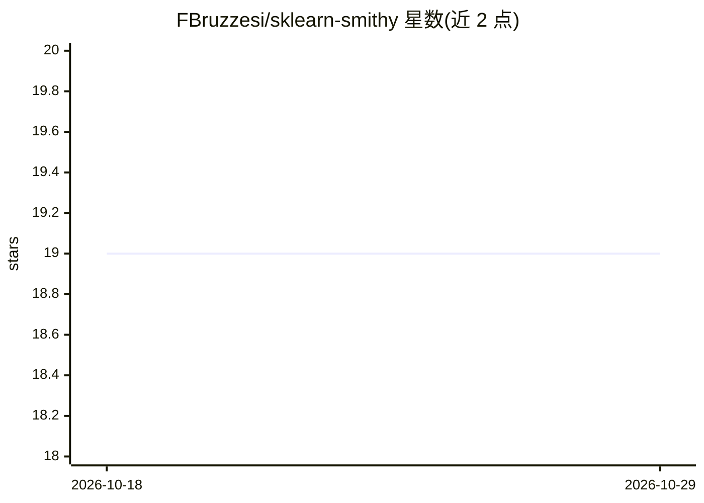

# FBruzzesi/sklearn-smithy

⭐ 19 · Python · MIT · 推送 2026-10-01 · [GitHub](https://github.com/FBruzzesi/sklearn-smithy) · [官网](https://sklearn-smithy.streamlit.app/) · 个人维护

**生成 scikit-learn 兼容估计器样板代码的工具**

通过问答式交互收集估计器类型、签名等信息，生成符合 scikit-learn API 规范的估计器样板代码，覆盖分类器、回归器、离群检测、聚类、转换器、特征选择器等 6 类（Meta Estimator 为进行中）。提供三种使用方式：浏览器 Web UI（免安装）、CLI（smith forge）与 TUI（smith forge-tui，需额外安装 textual 依赖）。通过 PyPI 安装，要求 Python 3.10 及以上。生成的代码可用 parametrize_with_checks 测试并兼容 Pipeline、GridSearchCV。

## 筛选速览

| 维度 | 判定 | 备注 |
|---|---|---|
| AI 角色 | `ai-ecosystem` | LLM/agent 周边工具 |
| 许可风险 | `permissive` | MIT |
| 部署形态 | `library` | 以包/库形式分发 |
| 模型依赖 | — | README 未给出锁定关系 |
| 硬件要求 | — | 无带数字的原话,不猜 |
| 安装摩擦 | `low` | 无编译、无系统依赖或容器化 |
| 成熟度 | — | 结构信号不足 |

## 能力要点

- 支持 6 类估计器样板代码生成（分类/回归/离群检测/聚类/转换/特征选择）
- 提供 Web UI、CLI、TUI 三种交互方式
- 生成代码兼容 scikit-learn Pipeline 与 GridSearchCV

## 适用场景

- 开发自定义 scikit-learn 估计器时生成样板代码
- 专注核心实现逻辑而跳过 API 细节
- 通过浏览器免安装快速生成估计器骨架

## 场景标签

`代码生成` · 领域:编码与开发

## 证据(README 行号)

> L3: Scikit-learn smithy is a tool that helps you to forge scikit-learn compatible estimator with ease.
> L27: All these tools will prompt a series of questions regarding the estimator you want to create, and then it will gene
> L66: ## Supported estimators

## 星数曲线

2026-10-18 19 → 2026-10-29 19（+0）

---
*卡片 v1 · prompt 1.4 · 生成 2026-10-29 · 置信度 high · 依据 README sha `be2745c62239` · [字段定义](../../DATASET.md)*
