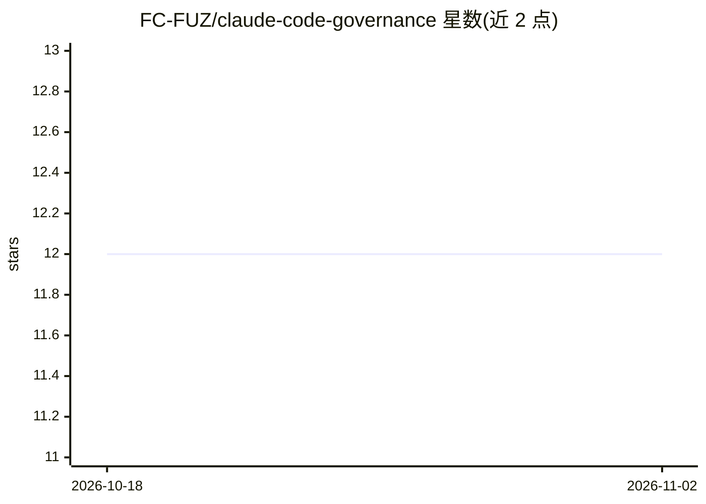

# FC-FUZ/claude-code-governance

⭐ 12 · Python · MIT · 推送 2026-03-16 · [GitHub](https://github.com/FC-FUZ/claude-code-governance) · 个人维护

**Claude Code 的自动化治理框架：多模型评审、WIP 恢复与安全门禁**

基于 Claude Code hooks 的治理层，含 7 个脚本、5 种事件类型：PreCompact/SessionStart 钩子实现工作进度检查点与跨会话恢复；bug 修复两次失败后经 OpenRouter 咨询 GPT/Gemini/Kimi 多模型评审；通过 Supermemory 存储跨项目记忆；敏感代码触发 Trail of Bits 静态分析；前端改动需 Playwright 截图验证方可报告完成。各外部服务缺失时优雅降级。安装需 Claude Code CLI、Python 3.10+ 与 OpenRouter API key，支持 bash install.sh 或手动复制脚本。

## 筛选速览

| 维度 | 判定 | 备注 |
|---|---|---|
| AI 角色 | `ai-ecosystem` | LLM/agent 周边工具 |
| 许可风险 | `permissive` | MIT |
| 部署形态 | `None` |  |
| 模型依赖 | locked-api |  |
| 硬件要求 | — | 无带数字的原话,不猜 |
| 安装摩擦 | `low` | 无编译、无系统依赖或容器化 |
| 成熟度 | — | 结构信号不足 |

## 能力要点

- 7 个 hook 脚本覆盖 5 种事件类型，自动检查点与 WIP 恢复
- 两次修复失败后经 OpenRouter 咨询 GPT/Gemini/Kimi 多模型评审
- 敏感代码路径自动触发 Trail of Bits 分析与多模型验证
- 外部服务（Supermemory/OpenRouter 等）不可用时优雅降级

## 适用场景

- 长会话中防止上下文压缩丢失任务状态
- 卡在 bug 修复循环时获得多模型第二意见
- 对认证/加密等敏感代码强制执行安全审查
- 前端改动完成前强制浏览器截图验证

## 场景标签

`浏览器自动化` `代码审查` `Agent 记忆` · 领域:Agent 开发

## 证据(README 行号)

> L14: **This framework fixes that** with automatic WIP checkpointing via Claude Code hooks, cross-session memory via Supe
> L165: No. The framework uses 7 hook scripts across 5 event types, each with tight timeouts (5-15 seconds). `SessionStart

## 星数曲线

2026-10-18 12 → 2026-11-02 12（+0）

---
*卡片 v1 · prompt 1.4 · 生成 2026-11-01 · 置信度 high · 依据 README sha `58727260db29` · [字段定义](../../DATASET.md)*
