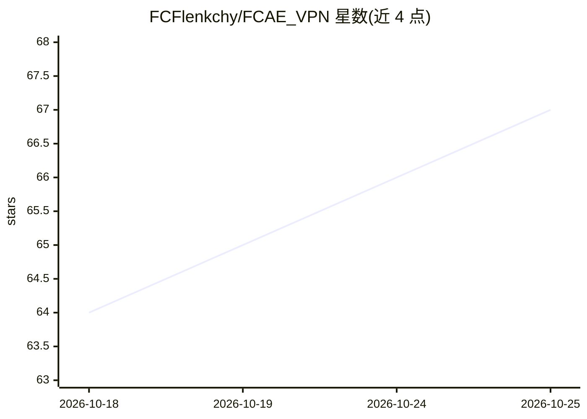

# FCFlenkchy/FCAE_VPN

⭐ 68 · Rust · AGPL-3.0 · 推送 2026-10-25 · [GitHub](https://github.com/FCFlenkchy/FCAE_VPN) · [官网](https://fcaevpn.fluxcast.dev/) · 个人维护 · 中文 README

**多平台翻墙 VPN 客户端，经 Cloudflare WARP 建加密隧道**

面向受限网络用户的审查规避客户端，基于 Aether 引擎构建，连接 Cloudflare WARP 网络。工作流程：首次启动向 Cloudflare 注册 API 申请设备身份与 WireGuard 密钥，扫描并验证边缘 IP，随后以 MASQUE（HTTP/3 或 HTTP/2）、WireGuard、WARP-in-WARP 或 WARP-in-MASQUE 四种协议之一建立加密隧道，并在本地暴露 SOCKS5（1819）与 HTTP（1820）代理。提供 Windows/Linux/macOS/Android 原生 GUI，支持 UI 内联路由规则（直连/阻断/域名/正则/CIDR 等）。安装需从源码编译（Rust 引擎 + CMake 构建 GUI），Android 经 Android Studio 构建。

## 筛选速览

| 维度 | 判定 | 备注 |
|---|---|---|
| AI 角色 | `ai-enhanced` | 去掉 AI 部分产品仍成立 |
| 许可风险 | `viral` | AGPL-3.0 |
| 部署形态 | `None` |  |
| 模型依赖 | — | README 未给出锁定关系 |
| 硬件要求 | — | 无带数字的原话,不猜 |
| 安装摩擦 | `medium` | 含编译或系统依赖之一 |
| 成熟度 | — | 结构信号不足 |

## 能力要点

- 四种隧道协议：MASQUE、WireGuard、WARP-in-WARP、WARP-in-MASQUE
- 自动端点扫描并以真实握手验证数据面连通性
- 本地 SOCKS5/HTTP 代理与 UI 内联路由规则（direct/block、域名/正则/CIDR/端口）
- Windows/Linux/macOS/Android 四平台原生 GUI

## 适用场景

- 在受限网络环境下经 Cloudflare WARP 接入互联网
- 让浏览器等应用通过本地 SOCKS5/HTTP 代理走加密隧道
- 按域名/IP/端口自定义直连或阻断规则

## 场景标签

 · 领域:网络/隐私工具

## 证据(README 行号)

> L9: A censorship circumvention client designed for heavily restricted networks. It automatically discovers reachable rou
> L11: Built on top of **Aether** with native GUI frontends for Windows, Linux, macOS, and Android.

## 星数曲线

2026-10-18 64 → 2026-10-25 67（+3）

---
*卡片 v1 · prompt 1.4 · 生成 2026-10-24 · 置信度 low · 依据 README sha `e1aa2c7835a8` · [字段定义](../../DATASET.md)*
