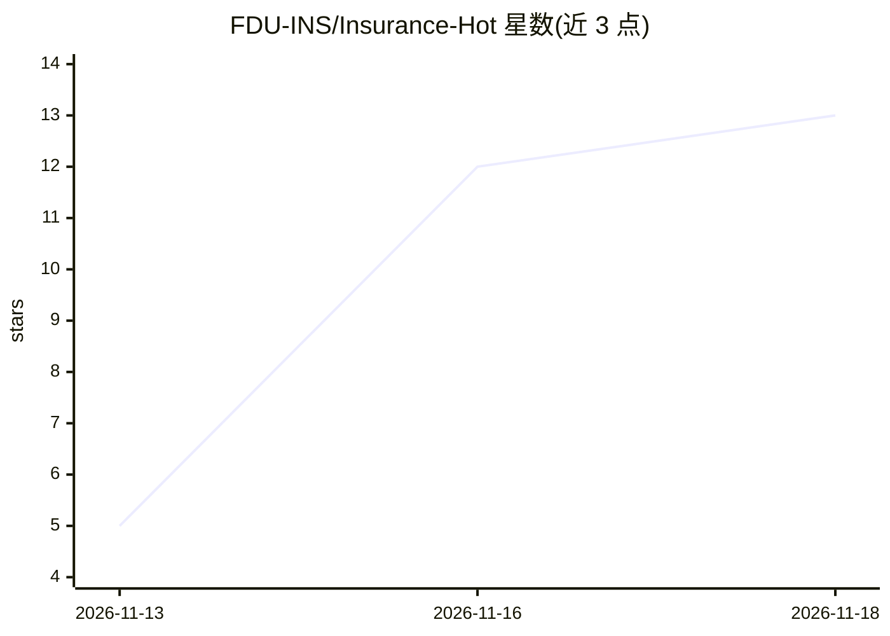

# FDU-INS/Insurance-Hot

⭐ 13 · 推送 2026-11-16 · [GitHub](https://github.com/FDU-INS/Insurance-Hot) · [官网](https://www.insurance-hot.com) · 组织维护 · 中文 README

**面向人与 AI 智能体的全球保险资讯聚合平台**

复旦大学许闲教授团队发布的保险资讯平台：汇聚监管公告、公司披露与行业报道，经筛选、分类、归并后提供实时精选、热点榜（中国/国际）、按险种/专题/机构的分类浏览，以及日报/周报/月报与邮件订阅。AI 侧提供远程只读 MCP 服务（Streamable HTTP）、REST API 与 RSS，配套 SKILL.md 技能文件以减少调用次数；使用需免费 API Key，每账号每日 100 次额度，接口只读、覆盖最近 1–30 天数据。

## 筛选速览

| 维度 | 判定 | 备注 |
|---|---|---|
| AI 角色 | `ai-enhanced` | 去掉 AI 部分产品仍成立 |
| 许可风险 | `none` | — |
| 部署形态 | `library` | 以包/库形式分发 |
| 模型依赖 | — | README 未给出锁定关系 |
| 硬件要求 | — | 无带数字的原话,不猜 |
| 安装摩擦 | `low` | 无编译、无系统依赖或容器化 |
| 成熟度 | — | 结构信号不足 |

## 能力要点

- 提供远程只读 MCP（Streamable HTTP）、REST API 与 RSS 三种接入方式
- 附带 skills/insurancehot 技能包，作者称装后一个问题通常 2–4 次调用
- 监管与行业协会一手发布单独标记，原文可溯
- 邮箱免费申请 API Key（ih_ 开头），每日 100 次额度

## 适用场景

- 让 AI 工具直接查询保险新闻、热点事件来龙去脉并引用原文
- 保险从业者每天浏览实时精选与热点榜
- 按险种或机构订阅日报/周报/月报邮件摘要
- 为合规岗位汇总当天监管政策与处罚动态

## 场景标签

 · 领域:金融保险/资讯聚合

## 证据(README 行号)

> L16: **InsuranceHot** 是复旦大学许闲教授团队发布的保险资讯平台。它把分散在各处的监管公告、公司披露和行业报道集中起来，经过筛选、分类、分析和归并，整理成实时更新、来源清晰、脉络完整的行业动态：保险从业者可以每天在网站上
> L85: InsuranceHot 提供一个远程只读 MCP 服务（Streamable HTTP）和同样内容的 REST API。接上之后，Agent 可以直接查询最新新闻、热点事件的来龙去脉和日报、周报、月报，回答时附上原文出处。
> L220: |**只读**|接口只读不写；不提供投保建议或报价|

## 星数曲线

2026-11-13 5 → 2026-11-18 13（+8）

---
*卡片 v1 · prompt 1.4 · 生成 2026-11-18 · 置信度 mid · 依据 README sha `a46e61f146d3` · [字段定义](../../DATASET.md)*
