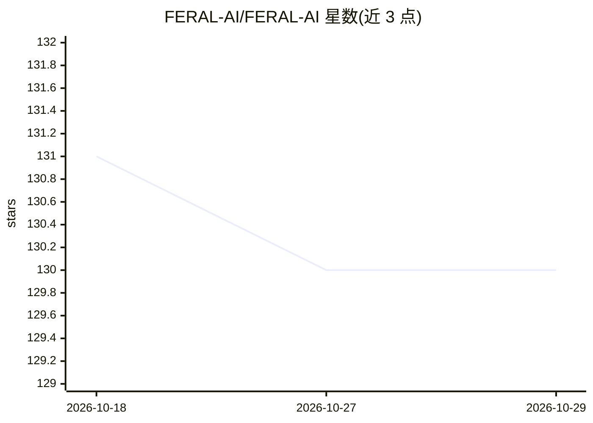

# FERAL-AI/FERAL-AI

⭐ 130 · Python · Apache-2.0 · 推送 2026-10-19 · [GitHub](https://github.com/FERAL-AI/FERAL-AI) · [官网](https://docs.feral.sh) · 组织维护

**本地优先的个人 AI 代理运行时：统一记忆、策略受控执行与设备连接**

在用户本机运行的 agent 运行时（feral-core 大脑 + web 控制端 + 设备桥），连接软件与硬件设备，提供四层记忆（工作上下文/情景事件/语义图检索/执行历史）、基于 FTS5 与 384 维向量的混合检索、Ebbinghaus 曲线遗忘策略，以及通过 CRDT + mDNS 在自有设备间同步、无云端中继。动作执行受审批/时间窗/每日上限策略门控。LLM 支持 OpenAI、Anthropic、Gemini、Groq、DeepSeek、OpenRouter、Ollama、LM Studio 等，可手机配对。公开 beta，macOS/Linux，Windows 需 WSL2，单用户部署为主。

## 筛选速览

| 维度 | 判定 | 备注 |
|---|---|---|
| AI 角色 | `ai-native` | 本体是模型或模型工具 |
| 许可风险 | `permissive` | Apache-2.0 |
| 部署形态 | `library` | 以包/库形式分发 |
| 模型依赖 | local-ok | 支持本地模型 |
| 硬件要求 | — | 无带数字的原话,不猜 |
| 安装摩擦 | `low` | 无编译、无系统依赖或容器化 |
| 成熟度 | `idea` | |

## 能力要点

- 四层记忆统一检索（FTS5 词法 + 384 维向量 + 实体图谱多跳遍历）
- CRDT + mDNS 设备间同步，无云中继，静置加密可选
- 策略门控执行：审批、时间窗、每日上限约束外部动作
- Server-driven UI：大脑输出结构化 UI，第三方应用交付契约

## 适用场景

- 在本机运行一个带长期记忆的个人 AI 助手并通过手机配对使用
- 让 agent 在受控策略下操作文件与硬件设备
- 跨自己的多台设备同步同一份记忆

## 场景标签

`Agent 记忆` `AI 助手` `Agent 框架` · 领域:Agent 开发

## 证据(README 行号)

> L29: FERAL is a local-first runtime that sits between your software and your physical devices. You run it on your own ma
> L168: 1. **LLM provider** — OpenAI, Anthropic, Gemini, Groq, DeepSeek, OpenRouter, Ollama, LM Studio — with masked API k
> L33: - **4-layer memory** — working context, episodic events, semantic / graph retrieval, and execution history.

## 星数曲线

2026-10-18 131 → 2026-10-29 130（-1）

---
*卡片 v1 · prompt 1.4 · 生成 2026-10-22 · 置信度 mid · 依据 README sha `0e077abc78ea` · [字段定义](../../DATASET.md)*
