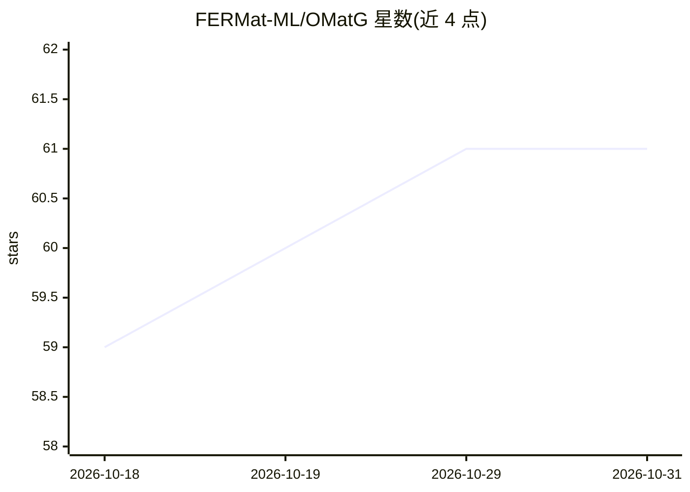

# FERMat-ML/OMatG

⭐ 61 · Python · MIT · 推送 2026-06-30 · [GitHub](https://github.com/FERMat-ML/OMatG) · [官网](https://openreview.net/forum?id=gHGrzxFujU) · 组织维护

**无机晶体结构预测与从头生成的生成式框架**

OMatG 是面向无机晶体材料的生成式建模框架，支持两种生成模式：晶体结构预测（CSP，固定原子种类、优化坐标与晶格）与从头生成（DNG，原子种类、坐标与晶格同时演化）。基于随机插值（stochastic interpolants）框架统一 flow-matching 与扩散方法，连续场（坐标/晶格）用插值、离散原子种类用离散流匹配；通过 PyTorch Lightning CLI 与 YAML 配置训练和生成，提供 Hugging Face 预训练权重、示例配置与 Kaggle 教程笔记本，LMDB/CSV 数据接口。配套 ICML/NeurIPS 论文与 OMatG-IRL 强化学习扩展。

## 筛选速览

| 维度 | 判定 | 备注 |
|---|---|---|
| AI 角色 | `ai-native` | 本体是模型或模型工具 |
| 许可风险 | `permissive` | MIT |
| 部署形态 | `library` | 以包/库形式分发 |
| 模型依赖 | — | README 未给出锁定关系 |
| 硬件要求 | — | 无带数字的原话,不猜 |
| 安装摩擦 | `medium` | 含编译或系统依赖之一 |
| 成熟度 | — | 结构信号不足 |

## 能力要点

- CSP 与 DNG 两种晶体生成模式
- 随机插值框架统一 flow-matching 与扩散方法，连续+离散（原子种类）混合建模
- YAML 配置驱动，基于 PyTorch Lightning CLI，可复现配置
- Hugging Face 提供预训练 checkpoint，Kaggle 提供教程笔记本

## 适用场景

- 给定成分预测稳定晶体结构
- 从头生成新的无机晶体材料
- 在自定义数据集上训练/微调晶体生成模型并复现论文设置

## 场景标签

`模型训练` `强化学习` · 领域:训练与推理

## 证据(README 行号)

> L21: A generative framework for crystal structure prediction and *de novo* generation of inorganic crystals.
> L75: OMatG implements the stochastic interpolants (SIs) framework for the modeling and
> L42: OMatG supports two crystal generation modes:

## 星数曲线

2026-10-18 59 → 2026-10-31 61（+2）

---
*卡片 v1 · prompt 1.4 · 生成 2026-10-24 · 置信度 high · 依据 README sha `1f1815a73c4d` · [字段定义](../../DATASET.md)*
