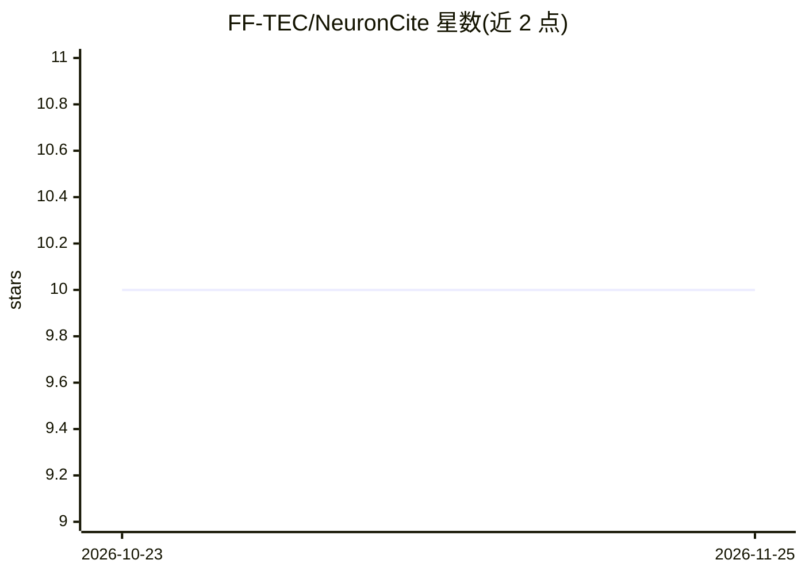

# FF-TEC/NeuronCite

⭐ 10 · Rust · AGPL-3.0 · 推送 2026-11-16 · [GitHub](https://github.com/FF-TEC/NeuronCite) · 个人维护

**本地隐私语义文档搜索与学术引用核验引擎**

Rust 编写的本地语义搜索引擎，将 PDF 文档库索为可检索知识库，并用本地 LLM 自动核验 LaTeX 论文中每条引用是否被原文献支持。检索采用 HNSW 向量、BM25（SQLite FTS5）与 RRF 融合，可选 cross-encoder 重排。核验流程解析引用命令、匹配 BibTeX 与 PDF，输出 7 种判定、置信度与修改建议。提供 Web GUI、CLI、REST API、Python 客户端及含 43 工具的 MCP 服务器；单二进制分发，首次下载模型后可完全离线运行；引用核验需运行 Ollama 实例。

## 筛选速览

| 维度 | 判定 | 备注 |
|---|---|---|
| AI 角色 | `ai-native` | 本体是模型或模型工具 |
| 许可风险 | `dual` | AGPL-3.0 |
| 部署形态 | `desktop` | 安装包/桌面程序 |
| 模型依赖 | local-ok | 支持本地模型 |
| 硬件要求 | `cpu-ok` | |
| 安装摩擦 | `low` | 无编译、无系统依赖或容器化 |
| 成熟度 | — | 结构信号不足 |

## 能力要点

- 混合检索：HNSW 向量 + BM25/FTS5 + RRF 融合，可选 cross-encoder 重排
- 五阶段引用核验流水线，输出 7 种判定与置信度及修改建议
- 内置 43 工具 MCP 服务器与 34 端点 REST API，供 AI 助手控制全流程
- 单二进制分发，模型下载后可完全离线，支持 air-gapped 环境

## 适用场景

- 在本地离线环境下检索 PDF 文献知识库
- 核验 LaTeX 论文引用是否被原始文献支持
- 让 Claude 等 AI 助手通过 MCP 直接索引与检索文档
- 按核验结果给 PDF 生成彩色标注

## 场景标签

`RAG` `语义搜索` `科研工具` · 领域:知识与检索

## 证据(README 行号)

> L11: NeuronCite is an enterprise-grade semantic search engine that transforms your
> L19: classified environments. A built-in MCP server with 43 tools lets AI assistants
> L33: NeuronCite indexes the cited PDFs, runs a local LLM via Ollama, and verifies

## 星数曲线

2026-10-23 10 → 2026-11-25 10（+0）

---
*卡片 v1 · prompt 1.4 · 生成 2026-11-20 · 置信度 high · 依据 README sha `7918b928452b` · [字段定义](../../DATASET.md)*
