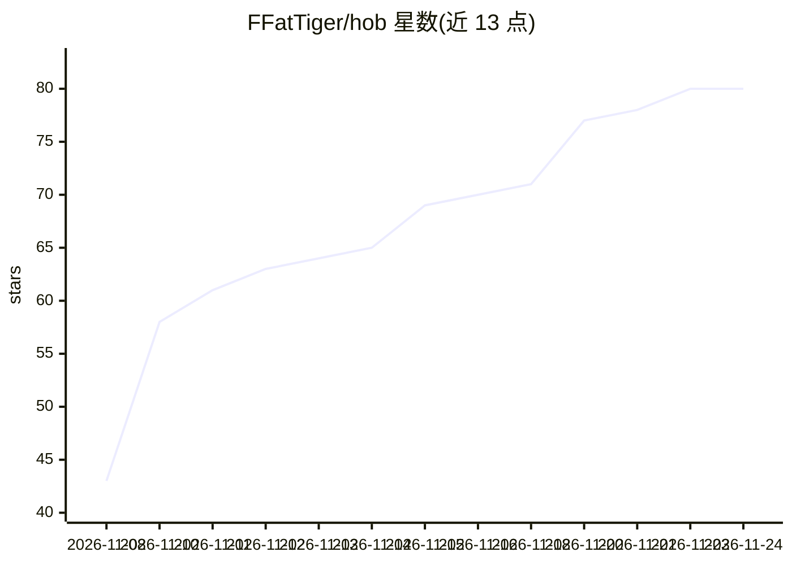

# FFatTiger/hob

⭐ 80 · TypeScript · MIT · 推送 2026-11-22 · [GitHub](https://github.com/FFatTiger/hob) · 个人维护 · 中文 README

**自托管单用户个人 AI 助理，后台执行任务并按规则请示**

运行在自有机器或服务器上的单用户个人助理应用：主助手即时处理小请求，较长工作交给后台 job（带实时转录、可中途追加指令或停止），并按全局/各助手规则决定哪些动作需用户确认，确认后可沉淀为规则。支持多助手组队（@指定成员、群主分发、各自用不同模型）、定时任务先跑检查脚本有变化才唤醒、完成的工作可写成带版本的技能。内置 Anthropic/OpenAI/Google/DeepSeek/OpenRouter 等模型接入、知识库、Web 搜索、MCP、记忆与可选云端桌面；提供 npm、Docker 与源码三种安装方式，需 Node.js 22+ 和至少一个模型 API key。

## 筛选速览

| 维度 | 判定 | 备注 |
|---|---|---|
| AI 角色 | `ai-native` | 本体是模型或模型工具 |
| 许可风险 | `permissive` | MIT |
| 部署形态 | `self-host` | docker 或自建部署 |
| 模型依赖 | locked-api |  |
| 硬件要求 | — | 无带数字的原话,不猜 |
| 安装摩擦 | `low` | 无编译、无系统依赖或容器化 |
| 成熟度 | — | 结构信号不足 |

## 能力要点

- 后台 job 机制：实时转录、追加指令、停止，结果回传对话
- 规则驱动的审批：可确认动作并保存为规则避免重复询问
- 多助手组队协作与任务委派（delegation card）
- 内置多模型供应商、知识库混合检索、MCP、云端桌面（可选）

## 适用场景

- 把长耗时工作交给后台 job 并随时查看进度
- 按自己的规则控制 AI 哪些动作需要先请示
- 组建多角色助手团队分工处理一个大任务

## 场景标签

`AI 助手` · 领域:对话与助手

## 证据(README 行号)

> L5: A self-hosted personal assistant. Tell it what you need: it handles small things on the spot,
> L21: - **You talk to assistants.** Each assistant has its own duties, rules, skills and schedules. It handles small requ
> L43: - **Models**: built-in providers such as Anthropic, OpenAI, Google, DeepSeek and OpenRouter only need an API key; a

## 星数曲线

2026-11-08 43 → 2026-11-24 80（+37）

---
*卡片 v1 · prompt 1.4 · 生成 2026-11-18 · 置信度 high · 依据 README sha `95141a60b051` · [字段定义](../../DATASET.md)*
