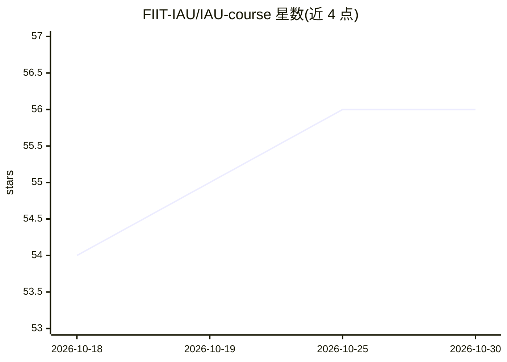

# FIIT-IAU/IAU-course

⭐ 56 · Jupyter Notebook · Apache-2.0 · 推送 2026-10-28 · [GitHub](https://github.com/FIIT-IAU/IAU-course) · 组织维护

**布拉迪斯拉发理工大学的数据科学导论课程仓库**

FIIT STU（斯洛伐克理工大学）IAU_B 课程 'Intelligent Data Analysis' 的课程主页仓库，面向本校学生。课程内容覆盖数据科学流程、数据分析技术、数据预处理、基础机器学习方法及其评估与比较，以构建数据驱动的智能应用为导向。仓库仅含课程结构链接（讲义、练习、课程条件、MS Teams、教材与参考文献），指向本校教材与 GÉRON、MCKINNEY 等推荐书目，并链接 MSc 层次的 ISA 课程。不提供可安装运行的软件。

## 筛选速览

| 维度 | 判定 | 备注 |
|---|---|---|
| AI 角色 | `ai-knowledge` | 知识聚合/清单类 |
| 许可风险 | `permissive` | Apache-2.0 |
| 部署形态 | `None` |  |
| 模型依赖 | — | README 未给出锁定关系 |
| 硬件要求 | — | 无带数字的原话,不猜 |
| 安装摩擦 | `low` | 无编译、无系统依赖或容器化 |
| 成熟度 | — | 结构信号不足 |

## 能力要点

- 课程覆盖数据科学流程、数据预处理与机器学习方法评估
- 含指定教材（NGUYEN 2022, Introduction to Data Science）与推荐书目
- 链接衔接 MSc 层次课程 FIIT-ISA

## 适用场景

- 选修该课程的学生获取课程结构与文献信息
- 查找数据科学入门的教学大纲与书目参考

## 场景标签

`教程课程` · 领域:学习与行业

## 证据(README 行号)

> L1: # Introduction to Data Science
> L4: By completing the course, students will acquire a comprehensive understanding of **data science process**, including
> L16: - NGUYEN, G., 2022. **Introduction to Data Science**. The Edition of University Textbooks on Informatics and Inform

## 星数曲线

2026-10-18 54 → 2026-10-30 56（+2）

---
*卡片 v1 · prompt 1.4 · 生成 2026-10-24 · 置信度 high · 依据 README sha `84a2eb468659` · [字段定义](../../DATASET.md)*
