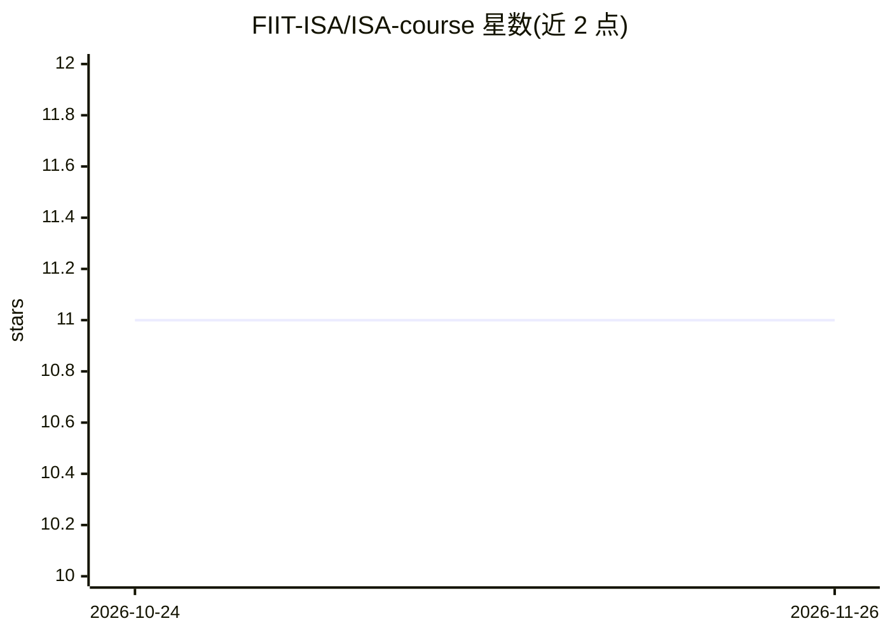

# FIIT-ISA/ISA-course

⭐ 11 · Jupyter Notebook · Apache-2.0 · 推送 2026-09-06 · [GitHub](https://github.com/FIIT-ISA/ISA-course) · 组织维护

**面向学生的生成式 AI 与应用机器学习课程资料库**

斯洛伐克布拉迪斯拉发 FIIT STU 大学 ISA_I 课程的教学仓库，主题覆盖神经推荐系统、机器学习系统与隐私保护机器学习。内容包含讲义、练习、项目与课程条件，配套 2026 年出版的同名校内教材（ISBN/DOI 已列出），并推荐 D2L、Designing ML Systems、推荐系统等参考书。先修要求为本科数据分析课程知识；讲义与练习具体内容在 README 中以目录占位，未展开。

## 筛选速览

| 维度 | 判定 | 备注 |
|---|---|---|
| AI 角色 | `ai-knowledge` | 知识聚合/清单类 |
| 许可风险 | `permissive` | Apache-2.0 |
| 部署形态 | `None` |  |
| 模型依赖 | — | README 未给出锁定关系 |
| 硬件要求 | — | 无带数字的原话,不猜 |
| 安装摩擦 | `low` | 无编译、无系统依赖或容器化 |
| 成熟度 | — | 结构信号不足 |

## 能力要点

- 课程覆盖生成式 AI 基础与应用机器学习的开发与部署
- 主题含神经推荐系统、ML 系统与隐私保护 ML
- 配套 Spektrum STU 出版的官方教材（ISBN 978-80-227-5556-6）
- 教学通过讲座、练习与个人项目进行

## 适用场景

- 修读该课程时查阅讲义与练习安排
- 了解生成式 AI 与应用 ML 课程的知识结构
- 按推荐书目系统学习深度学习与推荐系统

## 场景标签

`教程课程` · 领域:学习与行业

## 证据(README 行号)

> L1: # Foundations of GenAI and Applied ML
> L8: By completing the course, students will gain knowledge about the development and deployment of real-world intelligen
> L24: - NGUYEN, G., LYTVYN, O., 2026. **Foundations of Generative AI and Applied Machine Learning**. Spektrum STU Publish

## 星数曲线

2026-10-24 11 → 2026-11-26 11（+0）

---
*卡片 v1 · prompt 1.4 · 生成 2026-11-19 · 置信度 high · 依据 README sha `96594902f4a7` · [字段定义](../../DATASET.md)*
