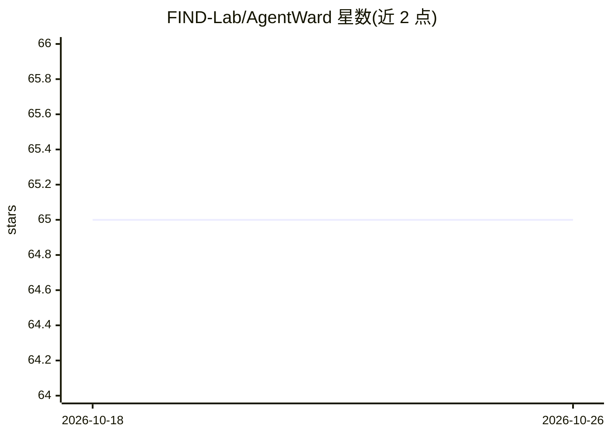

# FIND-Lab/AgentWard

⭐ 65 · TypeScript · Apache-2.0 · 推送 2026-06-04 · [GitHub](https://github.com/FIND-Lab/AgentWard) · 组织维护 · 中文 README

**面向 AI Agent 全生命周期的五层纵深防御安全操作系统**

AgentWard（玄甲）是面向 AI agent 部署的全栈安全系统，以插件形式原生适配 OpenClaw，将 agent 工作流重构为五层协同防御：基础扫描（供应链与基线完整性）、输入净化（提示注入与越狱检测）、认知保护（记忆投毒与上下文漂移）、决策对齐（意图一致性校验）与执行控制（高危操作拦截）。各层可独立启停，支持仅检测模式与自定义规则，威胁发生时可通过 IM 告警并自动阻断。安装通过 setup.sh 脚本完成并用 openclaw plugins list 验证；当前仅支持 Linux，macOS/Windows 在路线图中。附带架构论文的 BibTeX 引用信息。

## 筛选速览

| 维度 | 判定 | 备注 |
|---|---|---|
| AI 角色 | `ai-ecosystem` | LLM/agent 周边工具 |
| 许可风险 | `permissive` | Apache-2.0 |
| 部署形态 | `None` |  |
| 模型依赖 | — | README 未给出锁定关系 |
| 硬件要求 | — | 无带数字的原话,不猜 |
| 安装摩擦 | `low` | 无编译、无系统依赖或容器化 |
| 成熟度 | `idea` | |

## 能力要点

- 五层纵深防御覆盖启动、感知、记忆、决策、执行全链路
- 插件式原生集成 OpenClaw，脚本一键安装
- 各防御层可独立启停，支持仅检测模式与自定义规则
- 威胁响应：IM 告警、自动阻断高危操作

## 适用场景

- 给 OpenClaw agent 加装提示注入与越狱检测
- 拦截 agent 记忆投毒与高危命令执行
- 对 agent 决策做与用户意图的一致性校验

## 场景标签

`网络安全` · 领域:学习与行业

## 证据(README 行号)

> L3: **AgentWard (玄甲)** is a full-stack security operating system purpose-built for trustworthy, scalable AI agent deploy
> L37: **AgentWard** is natively and deeply integrated with the OpenClaw platform and embeds native security capabilities 

## 星数曲线

2026-10-18 65 → 2026-10-26 65（+0）

---
*卡片 v1 · prompt 1.4 · 生成 2026-10-24 · 置信度 high · 依据 README sha `205cb29b2a9a` · [字段定义](../../DATASET.md)*
