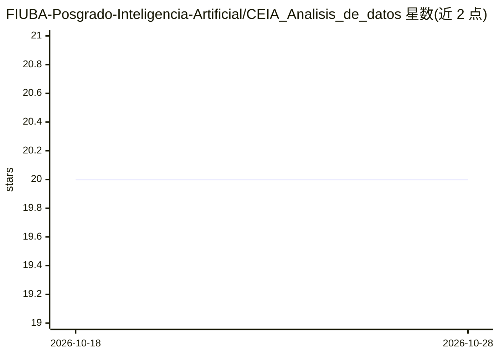

# FIUBA-Posgrado-Inteligencia-Artificial/CEIA_Analisis_de_datos

⭐ 20 · Jupyter Notebook · 推送 2026-10-27 · [GitHub](https://github.com/FIUBA-Posgrado-Inteligencia-Artificial/CEIA_Analisis_de_datos) · 组织维护

**FIUBA 数据分析研究生课程的教学材料仓库（notebooks+数据集）**

布宜诺斯艾利斯大学（FIUBA）人工智能专业方向的“数据分析”课程仓库，向在读与往届学生提供课堂 notebook、练习数据集、辅助脚本与函数工具，课程内容涵盖数据导入、Pandas 与探索性数据分析。幻灯片与作业说明存放在 FIUBA 研究生 Campus，仓库内不含。提供三种运行方式：Conda 环境（environment.yml）、Poetry 或 UV（pyproject.toml，需 Python 3.11/3.12）、以及在 Google Colab 中直接打开 notebook。

## 筛选速览

| 维度 | 判定 | 备注 |
|---|---|---|
| AI 角色 | `ai-knowledge` | 知识聚合/清单类 |
| 许可风险 | `none` | — |
| 部署形态 | `desktop` | 安装包/桌面程序 |
| 模型依赖 | — | README 未给出锁定关系 |
| 硬件要求 | — | 无带数字的原话,不猜 |
| 安装摩擦 | `low` | 无编译、无系统依赖或容器化 |
| 成熟度 | — | 结构信号不足 |

## 能力要点

- 按课程进度组织的 Jupyter notebook 与配套数据集
- 三种环境配置方式：Conda / Poetry / UV（Python 3.11 或 3.12）
- 支持在 Google Colab 中直接打开运行 notebook
- 包含 utils 辅助函数目录与往届学生获取内容的说明

## 适用场景

- 修读 FIUBA 数据分析课程的学生随堂练习与复习
- 往届学生按说明获取对应学期课程内容
- 在不配置本地环境的情况下用 Colab 运行课程 notebook

## 场景标签

`教程课程` · 领域:学习与行业

## 证据(README 行号)

> L1: Bienvenidos al repositorio de la materia **Análisis de Datos**! Aquí encontrarán los materiales de clase, notebooks,
> L24:  Introducción a Pandas. Ejemplos para importar datos desde distintas fuentes

## 星数曲线

2026-10-18 20 → 2026-10-28 20（+0）

---
*卡片 v1 · prompt 1.4 · 生成 2026-10-28 · 置信度 high · 依据 README sha `eac473bed47a` · [字段定义](../../DATASET.md)*
