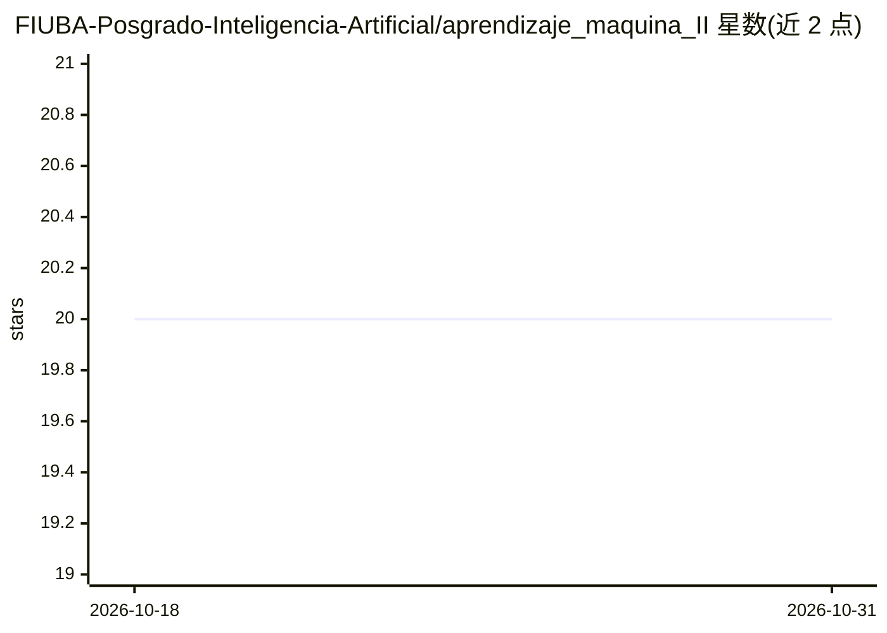

# FIUBA-Posgrado-Inteligencia-Artificial/aprendizaje_maquina_II

⭐ 20 · Jupyter Notebook · 推送 2026-10-26 · [GitHub](https://github.com/FIUBA-Posgrado-Inteligencia-Artificial/aprendizaje_maquina_II) · 组织维护

**FIUBA 研究生 MLOps 课程的教学材料仓库**

布宜诺斯艾利斯大学理工学院（FIUBA）人工智能研究生专业"机器学习运维 I"课程的官方材料仓库，含课堂演示文稿、练习与 Jupyter notebooks，按 clase1–clase7 七次课组织，覆盖 ML 生命周期、MLOps、Docker 容器、MLflow、Apache Airflow 工作流编排、模型离线/在线部署、REST API 与微服务。环境要求 Python≥3.10，提供 pyproject.toml 可用 uv 安装依赖，采用 CC BY-NC-SA 4.0 许可。仓库不包含可运行产品，仅为教学材料集合。

## 筛选速览

| 维度 | 判定 | 备注 |
|---|---|---|
| AI 角色 | `ai-knowledge` | 知识聚合/清单类 |
| 许可风险 | `none` | — |
| 部署形态 | `None` |  |
| 模型依赖 | — | README 未给出锁定关系 |
| 硬件要求 | — | 无带数字的原话,不猜 |
| 安装摩擦 | `low` | 无编译、无系统依赖或容器化 |
| 成熟度 | — | 结构信号不足 |

## 能力要点

- 按 7 次课组织，覆盖 MLflow、Airflow、Docker、模型部署与 REST API
- 含演示文稿、练习与 notebooks 三类材料
- 提供 pyproject.toml 支持 uv/Poetry/Pip/Conda 安装依赖

## 适用场景

- 按课程顺序系统学习 MLOps 概念与工具
- 获取 MLflow、Airflow、模型部署的动手练习材料
- 参考 MLOps 相关书目进行延伸阅读

## 场景标签

`教程课程` `MLOps` · 领域:学习与行业

## 证据(README 行号)

> L4: Este repositorio contiene el material de clases (presentaciones, ejercicios y notebooks) para Operaciones de Aprendi
> L9: El objetivo de la materia es acercar a los alumnos los conceptos necesarios para desarrollar productos de software r

## 星数曲线

2026-10-18 20 → 2026-10-31 20（+0）

---
*卡片 v1 · prompt 1.4 · 生成 2026-10-28 · 置信度 high · 依据 README sha `77d83950da3c` · [字段定义](../../DATASET.md)*
