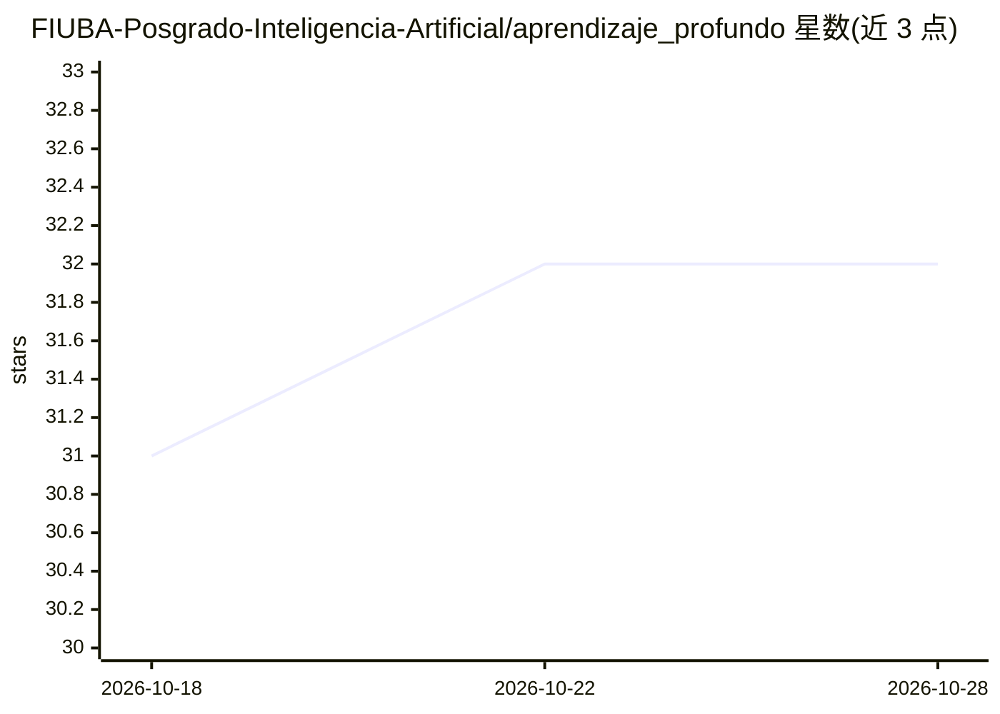

# FIUBA-Posgrado-Inteligencia-Artificial/aprendizaje_profundo

⭐ 32 · Jupyter Notebook · 推送 2026-10-07 · [GitHub](https://github.com/FIUBA-Posgrado-Inteligencia-Artificial/aprendizaje_profundo) · 组织维护

**FIUBA 深度学习研究生课程的课件与练习仓库**

布宜诺斯艾利斯工程学院（FIUBA）CEIA 研究生课程 Aprendizaje Profundo 的教学材料仓库，西班牙语编写，包含课程演示文稿、练习和 notebook。内容按 8 次课组织，覆盖前馈网络、激活与损失函数、PyTorch、正则化与超参数调整、CNN、RNN 与注意力层、Encoder-Decoder 与自编码器、迁移学习与 GAN。环境要求 Python 3.11，列有 Numpy/Pandas/SciPy/PyTorch 等依赖与 PyTest、PyCharm 工具。

## 筛选速览

| 维度 | 判定 | 备注 |
|---|---|---|
| AI 角色 | `ai-knowledge` | 知识聚合/清单类 |
| 许可风险 | `none` | — |
| 部署形态 | `None` |  |
| 模型依赖 | — | README 未给出锁定关系 |
| 硬件要求 | — | 无带数字的原话,不猜 |
| 安装摩擦 | `low` | 无编译、无系统依赖或容器化 |
| 成熟度 | — | 结构信号不足 |

## 能力要点

- 8 次课的完整教学大纲：从前馈网络到 GAN
- 涵盖 PyTorch、CNN、RNN/Attention、Autoencoder、迁移学习等主题
- 提供课件、练习与 notebook 三类材料

## 适用场景

- 跟读研究生级深度学习课程的讲义与练习
- 查找 CNN/RNN/GAN 等主题的入门教学 notebook

## 场景标签

`教程课程` · 领域:学习与行业

## 证据(README 行号)

> L1: # Deep Learning 2025-2026
> L2: Este repositorio contiene el material de clases (presentaciones, ejercicios y notebooks) para Deep Learning (CEIA - 

## 星数曲线

2026-10-18 31 → 2026-10-28 32（+1）

---
*卡片 v1 · prompt 1.4 · 生成 2026-10-26 · 置信度 high · 依据 README sha `430888cf73ce` · [字段定义](../../DATASET.md)*
