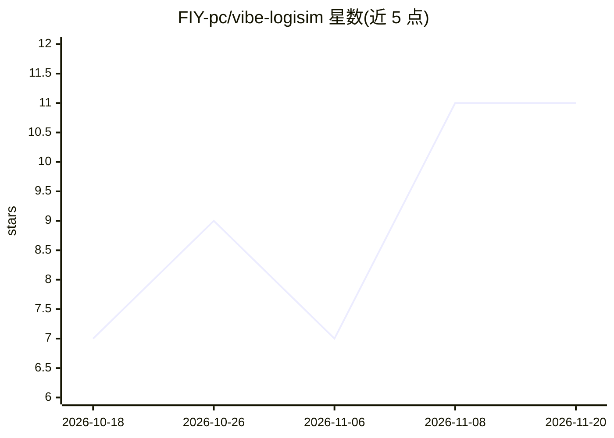

# FIY-pc/vibe-logisim

⭐ 11 · TypeScript · GPL-3.0 · 推送 2026-11-14 · [GitHub](https://github.com/FIY-pc/vibe-logisim) · 个人维护 · 中文 README

**计算机组成原理课程的 AI 电路工作台：画图仿真兼 AI 排错讲解**

面向计算机组成课程教学的数字电路工作台，将画图、仿真、文档查看与 AI 对话集成在同一窗口。用户可自然语言描述需求，AI Agent 在画布上搭建电路、解释原理、排查错误，改动可撤销。成果为标准 .circ 文件，兼容 Logisim-ITA 2.16 与 HUST 2020 版课程电路包。提供 Windows/Linux/macOS 桌面安装包，包内已捆绑 Java 与 Node.js；macOS 包为预览版，使用开发签名且尚未公证。

## 筛选速览

| 维度 | 判定 | 备注 |
|---|---|---|
| AI 角色 | `ai-enhanced` | 去掉 AI 部分产品仍成立 |
| 许可风险 | `viral` | GPL-3.0 |
| 部署形态 | `desktop` | 安装包/桌面程序 |
| 模型依赖 | — | README 未给出锁定关系 |
| 硬件要求 | — | 无带数字的原话,不猜 |
| 安装摩擦 | `medium` | 含编译或系统依赖之一 |
| 成熟度 | — | 结构信号不足 |

## 能力要点

- 自然语言驱动 AI 在画布上搭建与修改电路
- 选中电路让 AI 解释连接或查错，支持推时钟与信号追踪
- PDF/PPT/图片资料可放入工程并直接引用进对话
- 输出标准 .circ 文件，兼容 Logisim-ITA 2.16 与 HUST 2020 版

## 适用场景

- 计算机组成原理课上画电路和跑仿真
- 让 AI 搭全加器等电路并解释原理
- 让 AI 帮忙排查电路接线错误
- 打开老师发的 Logisim 课程电路包

## 场景标签

 · 领域:教育/EDA 工具

## 证据(README 行号)

> L5: 一个数字电路工作台：画图、仿真、看资料、和 AI 对话都在同一个窗口里。你可以自己画，也可以把需求说给 AI，让它实现电路、解释原理、排查错误，改动随时可以撤销。成果是普通的 `.circ` 文件，Logisim-ITA 2.16 
> L11: - **用自然语言搭电路。** 「搭一个一位全加器，验证真值表，解释进位怎么产生」，AI 直接改在画布上。
> L29: 打开就能画图和仿真。要用 AI，在右侧「连接 AI」登录 ChatGPT 或填自己的 API 服务。

## 星数曲线

2026-10-18 7 → 2026-11-20 11（+4）

---
*卡片 v1 · prompt 1.4 · 生成 2026-11-19 · 置信度 high · 依据 README sha `c21809d163de` · [字段定义](../../DATASET.md)*
