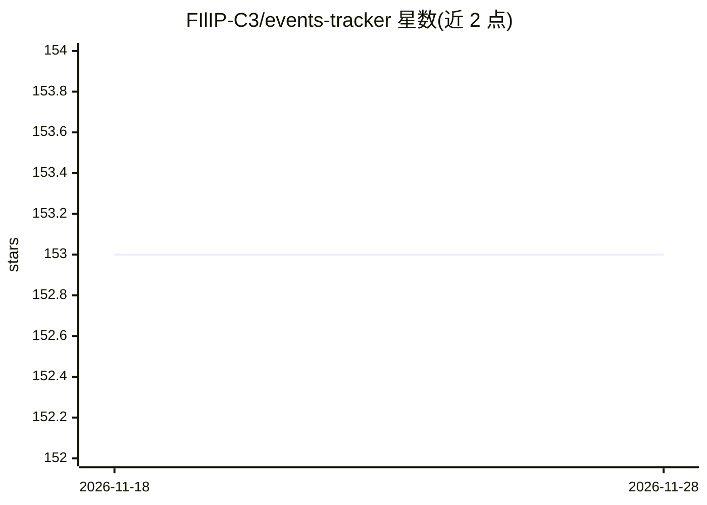

# FIlIP-C3/events-tracker

⭐ 153 · TypeScript · 推送 2026-11-27 · [GitHub](https://github.com/FIlIP-C3/events-tracker) · 个人维护

**团队日历与活动管理 Web 应用，AI 解析转发消息生成活动**

面向需要集中管理日程、演讲与论坛的团队的 Web 应用：提供周/月视图、多会话论坛（嵌套 session）、状态生命周期、按状态/负责人/时间过滤、事件负责人指派与每条事件的完整沟通记录。AI 部分为会话助手，解析转发的邀请、PDF 与海报生成待确认的活动草稿，并有 Telegram 机器人集成与定时提醒任务。部署依赖 PowerShell 5.1+ 与 Windows 10/11 x64，需自备托管数据库，MIT 许可。

## 筛选速览

| 维度 | 判定 | 备注 |
|---|---|---|
| AI 角色 | `ai-enhanced` | 去掉 AI 部分产品仍成立 |
| 许可风险 | `none` | — |
| 部署形态 | `None` |  |
| 模型依赖 | — | README 未给出锁定关系 |
| 硬件要求 | — | 无带数字的原话,不猜 |
| 安装摩擦 | `low` | 无编译、无系统依赖或容器化 |
| 成熟度 | — | 结构信号不足 |

## 能力要点

- AI 会话助手将转发邀请、PDF、海报解析为结构化活动草稿，人工确认后入库
- 多会话论坛建模：父事件下嵌套 session，各自带状态、负责人与沟通历史
- Telegram 机器人可读取转发消息并回答日程问题（可选组件）
- 双密码访问控制分离浏览与编辑权限，定时任务自动运行提醒

## 适用场景

- 团队统一管理会议、讲座与多日论坛的日程
- 把聊天中转发的邀请/海报自动变成待确认的日历活动
- 通过 Telegram 机器人随时查询团队日程

## 场景标签

`文档解析` `聊天机器人` · 领域:对话与助手

## 证据(README 行号)

> L42: **AI & Integrations** — A conversational assistant powered by a leading language model interprets forwarded invites
> L68: Not at all. The calendar, week and month views, forums, statuses, filters, and communication history work entirely 

## 星数曲线

2026-11-18 153 → 2026-11-28 153（+0）

---
*卡片 v1 · prompt 1.4 · 生成 2026-11-18 · 置信度 high · 依据 README sha `0517cfad0b3c` · [字段定义](../../DATASET.md)*
