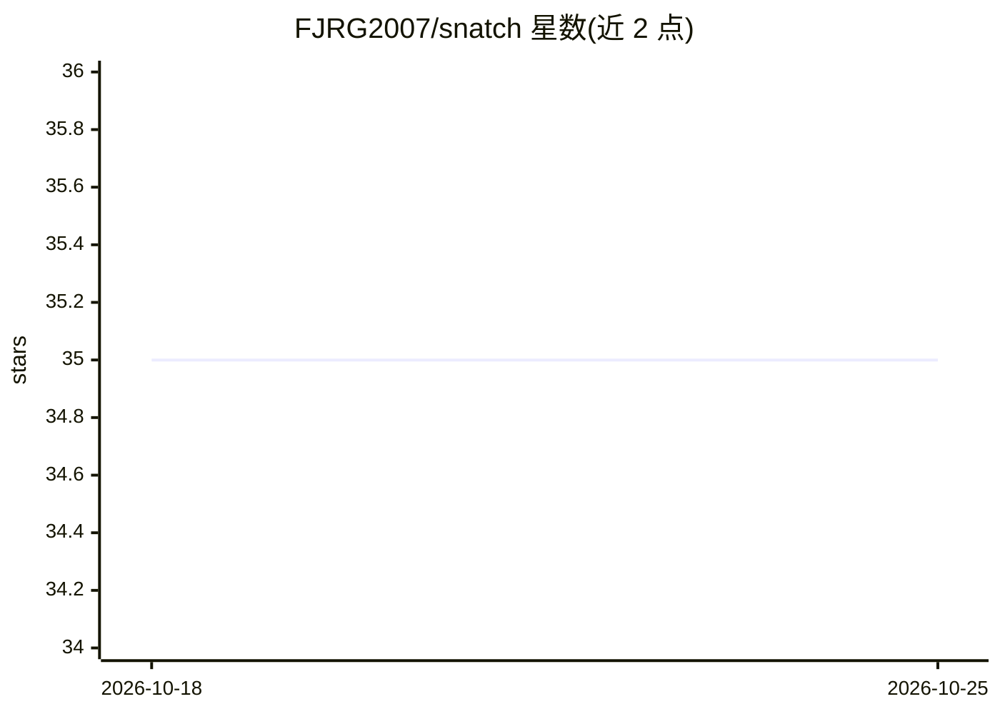

# FJRG2007/snatch

⭐ 35 · Python · AGPL-3.0 · 推送 2026-08-31 · [GitHub](https://github.com/FJRG2007/snatch) · [官网](https://tpe.li/P-SNATCH) · 个人维护

**已弃用的 AI 增强 OSINT 多功能工具：信息收集与下载**

面向网络安全与 OSINT 爱好者的 Python 多功能工具，通过自然语言 prompt 驱动模块执行信息收集任务，或直接以终端命令调用。模块涵盖端口扫描、网站/视频/数据下载、目录与子域名枚举、密码列表生成、WhatsApp 基础 OSINT 等；所有操作在本地执行，需自填 .env 中的 API token。支持 Anthropic/Groq/Ollama/OpenAI 等多家模型接入。注意：OSS 版本已被宣布弃用，后续版本将迁移至 Dymo 平台（2026 年 7 月起）。

## 筛选速览

| 维度 | 判定 | 备注 |
|---|---|---|
| AI 角色 | `ai-enhanced` | 去掉 AI 部分产品仍成立 |
| 许可风险 | `viral` | AGPL-3.0 |
| 部署形态 | `library` | 以包/库形式分发 |
| 模型依赖 | local-ok | 支持本地模型 |
| 硬件要求 | — | 无带数字的原话,不猜 |
| 安装摩擦 | `low` | 无编译、无系统依赖或容器化 |
| 成熟度 | `idea` | |

## 能力要点

- prompt 输入即可自主生成密码列表、识别邮箱与社交网络
- 端口扫描、子域名枚举、数据下载、密码生成等活跃模块
- 支持 8 家 AI 提供商（含 Ollama 本地执行）
- 所有操作本地执行，用户承担使用责任

## 适用场景

- 对目标做 OSINT 信息收集与侦察
- 批量下载网站、视频与数据
- 生成针对性密码列表与子域名枚举

## 场景标签

`网络安全` · 领域:学习与行业

## 证据(README 行号)

> L22: **Snatch** is a versatile tool crafted for cybersecurity and hacking enthusiasts. Developed in Python and currently
> L24: Imagine simply inputting a prompt that details all relevant information about your target. **Snatch** then autonomo
> L56: ### Main Features (Modules)

## 星数曲线

2026-10-18 35 → 2026-10-25 35（+0）

---
*卡片 v1 · prompt 1.4 · 生成 2026-10-25 · 置信度 mid · 依据 README sha `5030bdb4d3f7` · [字段定义](../../DATASET.md)*
