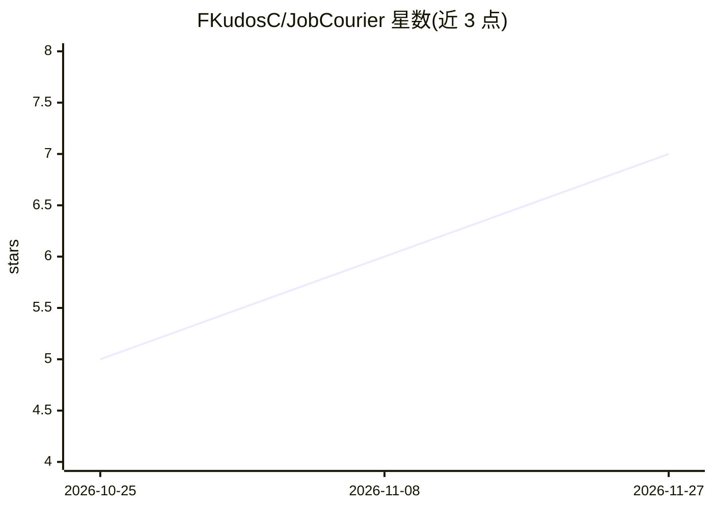

# FKudosC/JobCourier

⭐ 7 · Python · NOASSERTION · 推送 2026-10-18 · [GitHub](https://github.com/FKudosC/JobCourier) · 个人维护 · 中文 README

**本机运行的 BOSS 直聘 AI 智能投递助手**

跑在个人电脑上的 BOSS 直聘投递工具：按求职条件轮换关键词与城市自动浏览岗位，AI 按五个维度评分、识别骗子岗位并对比简历给出匹配度，只投达标岗位；支持按岗位自动生成定制简历并做事实校验、AI 自动回复 HR 消息、企业官网表单代填网申、验证码识图与公司风险查询。数据、简历与 API Key 均留在本机。后端 FastAPI、前端 React 19，浏览器自动化用 Patchright，依赖本机 Chrome 与 OpenAI 兼容大模型服务。

## 筛选速览

| 维度 | 判定 | 备注 |
|---|---|---|
| AI 角色 | `ai-native` | 本体是模型或模型工具 |
| 许可风险 | `none` | NOASSERTION |
| 部署形态 | `desktop` | 安装包/桌面程序 |
| 模型依赖 | local-ok | 支持本地模型 |
| 硬件要求 | — | 无带数字的原话,不猜 |
| 安装摩擦 | `low` | 无编译、无系统依赖或容器化 |
| 成熟度 | — | 结构信号不足 |

## 能力要点

- AI 岗位复核：五维评分与骗子岗位识别，总分由程序求和并按规则封顶
- 高分岗位自动生成定制简历，并对数字、日期、机构逐项做事实校验
- 网申助手扫描企业官网表单并按本机资料代填，AI 补全与视觉核对
- HR 消息 AI 自动回复，自动标记面试邀请、拒绝与待跟进状态

## 适用场景

- 按求职方向自动筛选并投递 BOSS 直聘岗位
- 网申时自动代填企业官网投递表单
- 自动回复 HR 消息并跟踪面试与沟通状态
- 投递前查询目标公司的工商与负面信息风险评估

## 场景标签

`浏览器自动化` `AI 写作` · 领域:效率与自动化

## 证据(README 行号)

> L7: 按设定的求职方向自动筛选岗位，用 AI 对比简历判断匹配度，只把简历投给合适的公司。
> L31: - **AI 岗位复核**：AI 逐个读岗位职责，识别骗子岗位，并按「核心职责匹配 / 可迁移证据 / 硬性要求 / 工具与技术栈 / 实际条件」五个维度打分，判断描述和匹配度都记在岗位库里
> L71: 另外准备一个大模型 API Key：任何 OpenAI 兼容服务都能接，比如通义千问、Kimi、智谱、OpenAI，也可以用本地 Ollama（API Key 随意填一个）。

## 星数曲线

2026-10-25 5 → 2026-11-27 7（+2）

---
*卡片 v1 · prompt 1.4 · 生成 2026-11-20 · 置信度 high · 依据 README sha `0009817b74a7` · [字段定义](../../DATASET.md)*
