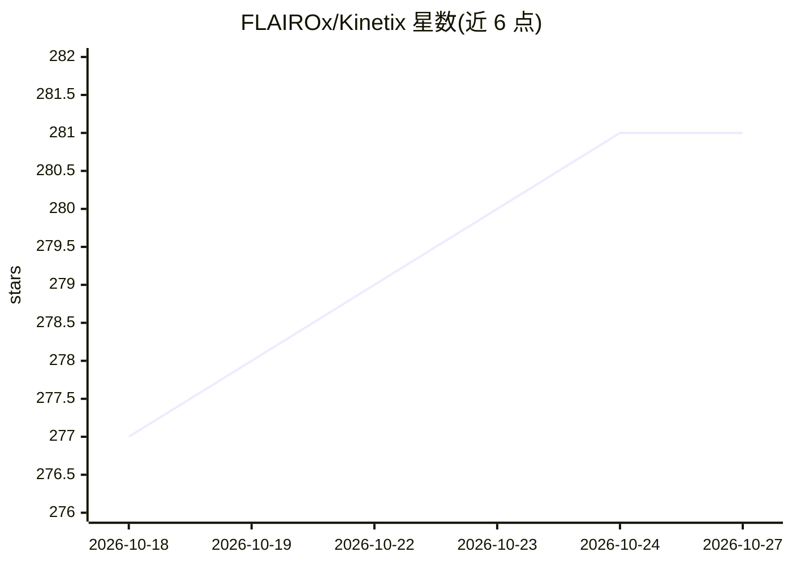

# FLAIROx/Kinetix

⭐ 281 · Python · MIT · 推送 2026-09-24 · [GitHub](https://github.com/FLAIROx/Kinetix) · [官网](https://kinetix-env.github.io/) · 组织维护

**JAX 2D 刚体物理世界中的强化学习研究框架**

完全用 JAX 编写的 2D 刚体物理强化学习框架（ICLR 2025 Oral）：以统一表示描述大量物理任务，通过程序化生成数百万任务训练大规模通用 RL agent。遵循 gymnax 接口，提供 SFL/PLR/PPO 实验脚本（hydra 配置、wandb 日志）、关卡编辑器、两个预训练通用 agent checkpoint、离线专家轨迹数据集（326GB，zarr 格式）与行为克隆训练脚本，PPO/SFL 支持多 GPU 并行。限制：JAX 编译耗时较长，环境分 s/m/l 三种尺寸需显式设置。

## 筛选速览

| 维度 | 判定 | 备注 |
|---|---|---|
| AI 角色 | `ai-ecosystem` | LLM/agent 周边工具 |
| 许可风险 | `permissive` | MIT |
| 部署形态 | `library` | 以包/库形式分发 |
| 模型依赖 | — | README 未给出锁定关系 |
| 硬件要求 | — | 无带数字的原话,不猜 |
| 安装摩擦 | `low` | 无编译、无系统依赖或容器化 |
| 成熟度 | — | 结构信号不足 |

## 能力要点

- 统一框架内程序化生成数百万 2D 物理任务
- SFL/PLR/PPO 实验脚本与 hydra 配置管理
- 发布两个预训练通用 agent（含 376B env steps 训练版本）
- 326GB 离线专家轨迹数据集与行为克隆支持，PPO/SFL 多 GPU 并行

## 适用场景

- 研究大规模通用强化学习 agent 的训练与零样本迁移
- 在程序化生成的 2D 物理任务上跑 PPO/PLR/SFL 实验
- 基于离线专家数据做行为克隆训练与评测

## 场景标签

`强化学习` `模型训练` · 领域:训练与推理

## 证据(README 行号)

> L22: Kinetix is a framework for reinforcement learning in a 2D rigid-body physics world, written entirely in JAX.
> L24: We use Kinetix to investigate the training of large, general reinforcement learning agents by procedurally generati
> L86: We have three primary experiment files,

## 星数曲线

2026-10-18 277 → 2026-10-27 281（+4）

---
*卡片 v1 · prompt 1.4 · 生成 2026-10-22 · 置信度 high · 依据 README sha `5b54b3a0d495` · [字段定义](../../DATASET.md)*
