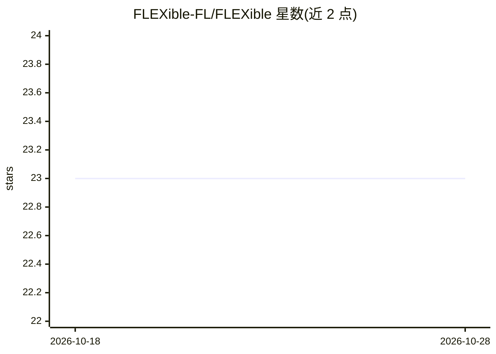

# FLEXible-FL/FLEXible

⭐ 23 · Python · AGPL-3.0 · 推送 2026-09-04 · [GitHub](https://github.com/FLEXible-FL/FLEXible) · 组织维护

**Python 联邦学习实验模拟框架：联邦化数据与模型**

面向研究人员与开发者的开源联邦学习框架，提供联邦数据集（MNIST、CIFAR10、Shakespeare 等）、自定义数据联邦化工具、可配置的客户端-服务器/点对点架构与角色（Server/Aggregator/Client）、FlexPool 编排器、装饰器与 PyTorch/TensorFlow 原语，以及 FedAVG 等聚合器。通过 pip 安装或本地源码安装，可选框架后端。附带示例 notebook 与 ReadTheDocs 文档，发表于 Information Fusion。

## 筛选速览

| 维度 | 判定 | 备注 |
|---|---|---|
| AI 角色 | `ai-ecosystem` | LLM/agent 周边工具 |
| 许可风险 | `viral` | AGPL-3.0 |
| 部署形态 | `library` | 以包/库形式分发 |
| 模型依赖 | — | README 未给出锁定关系 |
| 硬件要求 | — | 无带数字的原话,不猜 |
| 安装摩擦 | `low` | 无编译、无系统依赖或容器化 |
| 成熟度 | — | 结构信号不足 |

## 能力要点

- 内置多个联邦数据集并支持导入 torchvision/torchtext/datasets/tensorflow_datasets 数据
- 支持客户端-服务器、点对点及自定义联邦架构与多角色节点
- 提供 PyTorch 与 TensorFlow 原语及装饰器将集中式实验迁移到联邦场景
- 内置 FedAVG、WeightedFedAVG 聚合器，支持自定义聚合器

## 适用场景

- 在模拟环境中运行联邦学习实验并测试模型
- 将自己的数据集联邦化后训练自定义模型
- 研究不同联邦架构（客户端-服务器/点对点/纵向联邦）的效果

## 场景标签

`模型训练` · 领域:训练与推理

## 证据(README 行号)

> L6: FLEXible (Federated Learning Experiments) is an open source Federated Learning (FL) framework that provides a set of
> L15: - FLEXible provides its own decorators to define the federated functions. Also, FLEXible provides a set of primitiv

## 星数曲线

2026-10-18 23 → 2026-10-28 23（+0）

---
*卡片 v1 · prompt 1.4 · 生成 2026-10-27 · 置信度 high · 依据 README sha `9b65a91bba90` · [字段定义](../../DATASET.md)*
