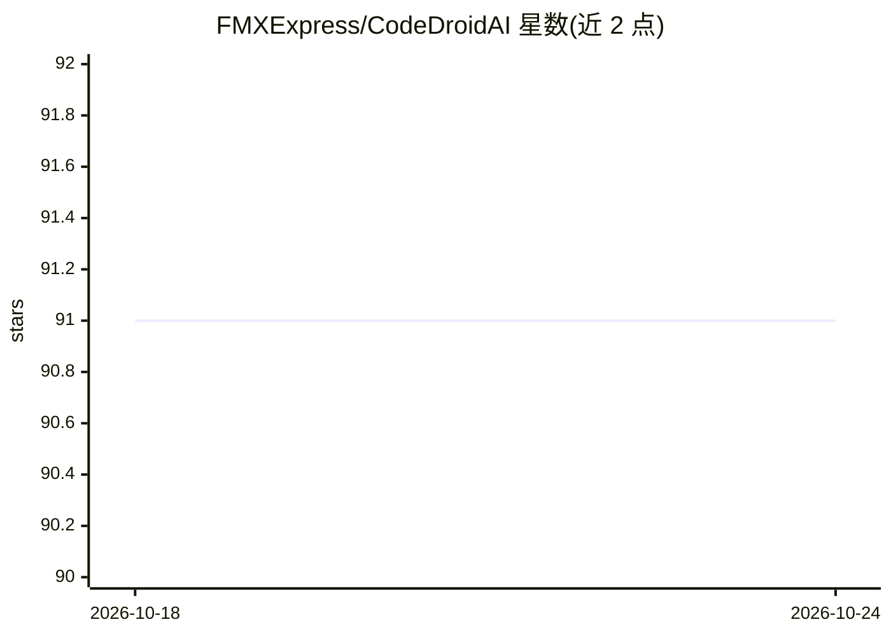

# FMXExpress/CodeDroidAI

⭐ 91 · Pascal · MIT · 推送 2026-03-11 · [GitHub](https://github.com/FMXExpress/CodeDroidAI) · [官网](https://www.fmxexpress.com/) · 个人维护

**用 LLM 为 Delphi/C++Builder 生成代码与窗体的桌面客户端**

基于 FireMonkey 框架开发的桌面客户端，面向 Delphi Object Pascal 与 C++Builder 开发者，通过 OpenAI.com 与 Replicate.com 的 REST 集成调用 LLM 生成代码和 VCL/FMX 窗体；可将生成的 Delphi/C++ 代码实际编译并把错误回传给 ChatGPT 修正。内置模板系统扩展代码生成选项，支持 gpt-3.5-turbo、gpt-4、vicuna-13b、gpt4all、codellama 等十余种模型，Replicate 模型可云端或本地 docker 运行。当前仅面向 Windows 配置。

## 筛选速览

| 维度 | 判定 | 备注 |
|---|---|---|
| AI 角色 | `ai-native` | 本体是模型或模型工具 |
| 许可风险 | `permissive` | MIT |
| 部署形态 | `self-host` | docker 或自建部署 |
| 模型依赖 | — | README 未给出锁定关系 |
| 硬件要求 | — | 无带数字的原话,不猜 |
| 安装摩擦 | `low` | 无编译、无系统依赖或容器化 |
| 成熟度 | — | 结构信号不足 |

## 能力要点

- 生成过程/窗体/VCL↔FMX 转换/跨语言转换等 13 项内置功能
- 编译生成的 Delphi/C++ 代码并将错误回传 ChatGPT 修正
- 支持 OpenAI 与 Replicate REST 集成，十余种模型可选
- 内置模板系统扩展代码生成选项

## 适用场景

- Delphi 开发者让 LLM 生成过程、窗体与单元测试
- 将旧 Delphi ANSI 代码升级为 Unicode 或转换为 C++
- 借助编译验证循环让 AI 自动修正生成代码的错误

## 场景标签

`代码生成` · 领域:编码与开发

## 证据(README 行号)

> L2: Generate code and forms with AI for Delphi Object Pascal using LLMs like ChatGPT and Vicuna-13b.
> L4: The CodeDroidAI Desktop client is a powerful UI for generate code and forms for Delphi and C++Builder. Comes with th
> L42: It features a REST integration with OpenAI.com (ChatGPT) and Replicate.com for providing source code generation fun

## 星数曲线

2026-10-18 91 → 2026-10-24 91（+0）

---
*卡片 v1 · prompt 1.4 · 生成 2026-10-23 · 置信度 mid · 依据 README sha `471fd396c1eb` · [字段定义](../../DATASET.md)*
