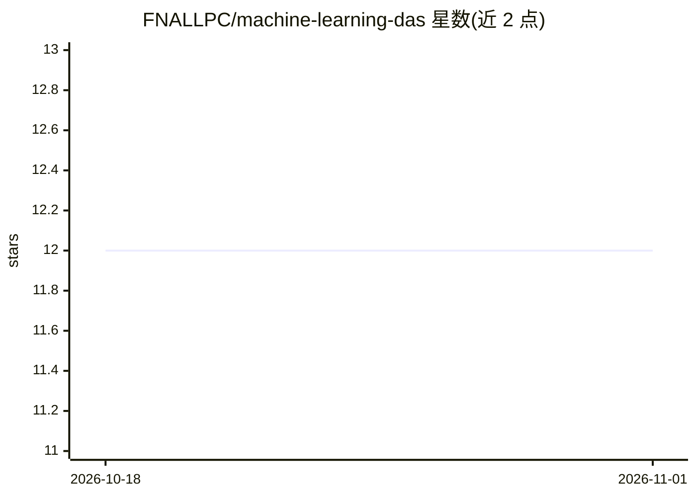

# FNALLPC/machine-learning-das

⭐ 12 · Jupyter Notebook · MIT · 推送 2026-10-12 · [GitHub](https://github.com/FNALLPC/machine-learning-das) · [官网](https://fnallpc.github.io/machine-learning-das/) · 组织维护

**LPC DAS 机器学习短课教程集：用多框架构建粒子物理分类器**

费米实验室 LPC 数据分析学校（DAS）机器学习短练习的 Jupyter Book 教程集合：面向 CMS 高能物理分析人员，示范用 xgboost、Keras、TensorFlow、PyTorch 构建事件级与喷注级分类器（VBF Higgs 对本底、boosted W 对 QCD），并涉及 GNN、VAE、GAN 等进阶模型。运行方式包括 Vanderbilt Jupyterhub（推荐）、FNAL LPC、本地 mamba 环境、Binder 与 Google Colab；教程数据集通过 DOI 提供。

## 筛选速览

| 维度 | 判定 | 备注 |
|---|---|---|
| AI 角色 | `ai-knowledge` | 知识聚合/清单类 |
| 许可风险 | `permissive` | MIT |
| 部署形态 | `None` |  |
| 模型依赖 | — | README 未给出锁定关系 |
| 硬件要求 | — | 无带数字的原话,不猜 |
| 安装摩擦 | `low` | 无编译、无系统依赖或容器化 |
| 成熟度 | — | 结构信号不足 |

## 能力要点

- 覆盖 xgboost/Keras/TensorFlow/PyTorch 四种框架的分类器构建
- 包含 VBF Higgs 与 boosted W 喷注两类物理分类案例
- 进阶主题含 GNN、VAE、GAN
- 数据集以 DOI 发布，可在 Jupyterhub/Binder/Colab 运行

## 适用场景

- 参加 CMS DAS 学校的学员按教程练习机器学习分析
- 高能物理研究人员学习如何在 ROOT 分析中引入 ML 模型
- 在 Colab 或 Binder 上快速复现教程笔记本

## 场景标签

`教程课程` · 领域:学习与行业

## 证据(README 行号)

> L15: This is a set of tutorials for the LPC Data Analysis School (DAS) Machine Learning Short Exercise.
> L16: They are intended to show you how to build machine learning models in python, using `xgboost`, `Keras`, `TensorFlow

## 星数曲线

2026-10-18 12 → 2026-11-01 12（+0）

---
*卡片 v1 · prompt 1.4 · 生成 2026-11-01 · 置信度 high · 依据 README sha `2376655efcc7` · [字段定义](../../DATASET.md)*
