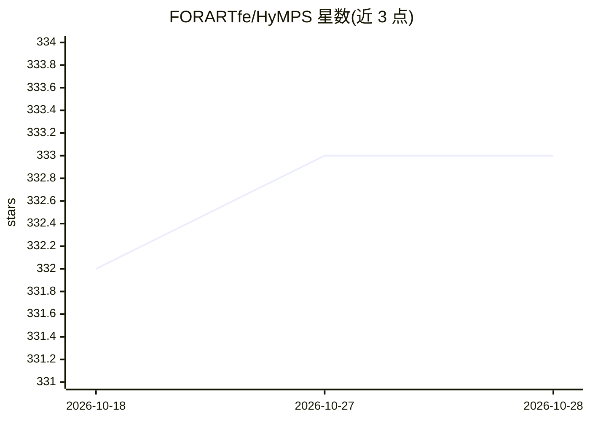

# FORARTfe/HyMPS

⭐ 333 · GPL-3.0 · 推送 2026-10-26 · [GitHub](https://github.com/FORARTfe/HyMPS) · [官网](https://forart.it/HyMPS) · 个人维护

**音视频制作软件资源策展清单（AI 音频/视频分类）**

面向音视频内容制作的资源聚合仓库：按音频与视频两大板块组织，音频下设 DAW、DSP、效果器、合成器、录音机等 18 个分类，视频下设编辑器、处理、PTZ、RTSP 等 7 个分类，两板块各含 AI-based 分类。README 目前以分类标题为主，未展示具体条目内容；声明将（will be）成为跨平台的音视频制作软件套件。给寻找相关工具的用户作目录检索用。

## 筛选速览

| 维度 | 判定 | 备注 |
|---|---|---|
| AI 角色 | `ai-knowledge` | 知识聚合/清单类 |
| 许可风险 | `viral` | GPL-3.0 |
| 部署形态 | `None` |  |
| 模型依赖 | — | README 未给出锁定关系 |
| 硬件要求 | — | 无带数字的原话,不猜 |
| 安装摩擦 | `low` | 无编译、无系统依赖或容器化 |
| 成熟度 | `idea` | |

## 能力要点

- 音频板块含 AI-based 在内 18 个分类
- 视频板块含 AI-based 在内 7 个分类
- 覆盖 DAW、DSP、效果器、合成器、RTSP 等工具类别

## 适用场景

- 按分类浏览音视频制作相关的开源工具
- 查找 AI 音频/AI 视频方向的软件资源
- 了解音视频制作工具的分类体系

## 场景标签

`精选清单` · 领域:学习与行业

## 证据(README 行号)

> L2: It will be a platform-indipendent software suite for advanced audio/video contents production.
> L4: ## AUDIO
> L22: ## VIDEO

## 星数曲线

2026-10-18 332 → 2026-10-28 333（+1）

---
*卡片 v1 · prompt 1.4 · 生成 2026-10-21 · 置信度 low · 依据 README sha `1be1b8d5fee7` · [字段定义](../../DATASET.md)*
