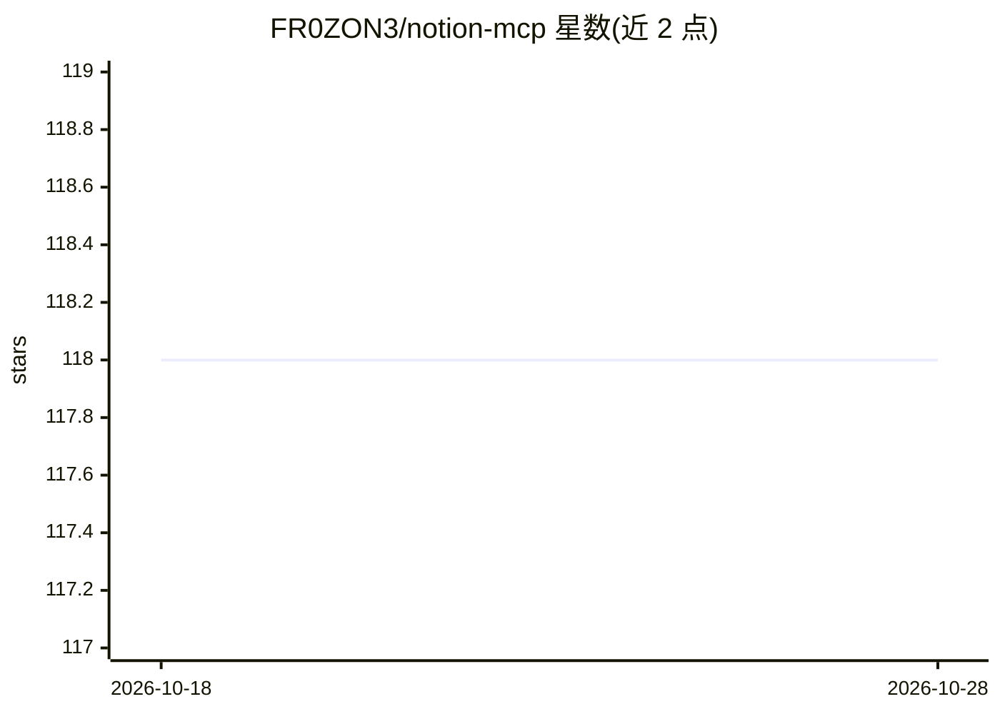

# FR0ZON3/notion-mcp

⭐ 118 · TypeScript · MIT · 推送 2026-09-14 · [GitHub](https://github.com/FR0ZON3/notion-mcp) · 个人维护

**连接 AI 代理与 Notion 的 MCP 服务器，以 Markdown 读写**

面向 AI agent 与 Notion 集成的 MCP 服务器：代理以 GFM Markdown 读写页面，服务器负责块转换、数据库 schema 映射、OAuth 与可选 Redis 持久化。提供 42 个 MCP 工具、24 种块类型的往返转换，支持 Stdio 与 HTTP 双传输（含 bearer/OAuth）。需 Node.js 20+ 与 Notion 集成 token；Redis 为可选，file:// 上传仅限 stdio。约 850 个单元测试，MIT 许可。

## 筛选速览

| 维度 | 判定 | 备注 |
|---|---|---|
| AI 角色 | `ai-ecosystem` | LLM/agent 周边工具 |
| 许可风险 | `permissive` | MIT |
| 部署形态 | `library` | 以包/库形式分发 |
| 模型依赖 | — | README 未给出锁定关系 |
| 硬件要求 | — | 无带数字的原话,不猜 |
| 安装摩擦 | `low` | 无编译、无系统依赖或容器化 |
| 成熟度 | — | 结构信号不足 |

## 能力要点

- 42 个 MCP 工具，Markdown-first I/O，代理无需构造 Notion 块 JSON
- 24 种块类型的往返转换（toggles/columns/callouts/tables/uploads）
- Stdio 与 HTTP 双传输，支持 OAuth 与 bearer 静态 token
- 可选 Redis 共享 schema 缓存与 OAuth token 持久化，失联时回退内存/文件

## 适用场景

- 让 Claude Code、Cursor 等 MCP 客户端读写 Notion 页面
- 以自然 Markdown 维护 Notion 数据库而无需处理块 JSON
- 多实例部署时用 Redis 共享 schema 缓存与 OAuth token

## 场景标签

`知识库管理` · 领域:知识与检索

## 证据(README 行号)

> L3: Production-oriented MCP server that connects AI agents to Notion through standard markdown instead of raw API JSON.
> L11: |**Markdown-first I/O**|42 MCP tools; agents never construct Notion block JSON|
> L24:     CC[Claude Code / Cursor]

## 星数曲线

2026-10-18 118 → 2026-10-28 118（+0）

---
*卡片 v1 · prompt 1.4 · 生成 2026-10-23 · 置信度 high · 依据 README sha `26f2b1ebbf01` · [字段定义](../../DATASET.md)*
