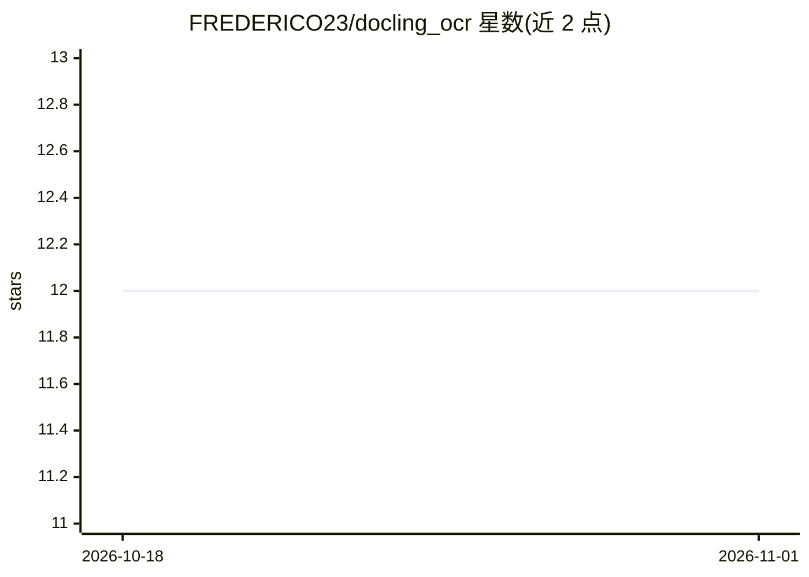

# FREDERICO23/docling_ocr

⭐ 12 · Python · MIT · 推送 2026-08-29 · [GitHub](https://github.com/FREDERICO23/docling_ocr) · 个人维护

**基于 LLM 的图片/文档文字提取 Python 库**

基于 SmolDocling 等文档理解语言模型的 Python 包，从扫描文档、表单、收据等图片提取文本，支持 PIL 图像输入、批量目录处理与文件输出。默认有 CUDA 时使用 GPU，也可指定 CPU 或具体显卡；可更换同族模型并调整生成长度。依赖 Python 3.7+、PyTorch 1.10.0+、Transformers 4.15.0+ 与 Pillow 8.0.0+；无 NVIDIA GPU 时需先安装 CPU 版 PyTorch 以避免 CUDA 库导入错误。路线图中 PDF 多页与结构化输出尚未提供。

## 筛选速览

| 维度 | 判定 | 备注 |
|---|---|---|
| AI 角色 | `ai-native` | 本体是模型或模型工具 |
| 许可风险 | `permissive` | MIT |
| 部署形态 | `library` | 以包/库形式分发 |
| 模型依赖 | — | README 未给出锁定关系 |
| 硬件要求 | `cpu-ok` | |
| 安装摩擦 | `medium` | 含编译或系统依赖之一 |
| 成熟度 | — | 结构信号不足 |

## 能力要点

- SmolDoclingExtractor 提供文件与 PIL 图像两种输入
- batch_process 支持整目录批量处理
- 可指定 device（cpu/cuda:0）与同族模型变体
- 抽象基类支持扩展新模型

## 适用场景

- 从扫描表单、收据、发票图片中提取文本
- 批量处理整个目录下的文档图片
- 在无 GPU 环境用 CPU 模式运行文档文字提取

## 场景标签

`OCR` · 领域:感知与多模态

## 证据(README 行号)

> L7: A powerful Python package for extracting text from images and documents using advanced LLM-based models.
> L13: Built on top of models like SmolDocling, this package provides a simple, intuitive interface for document text extr

## 星数曲线

2026-10-18 12 → 2026-11-01 12（+0）

---
*卡片 v1 · prompt 1.4 · 生成 2026-11-01 · 置信度 high · 依据 README sha `fc29530bef50` · [字段定义](../../DATASET.md)*
