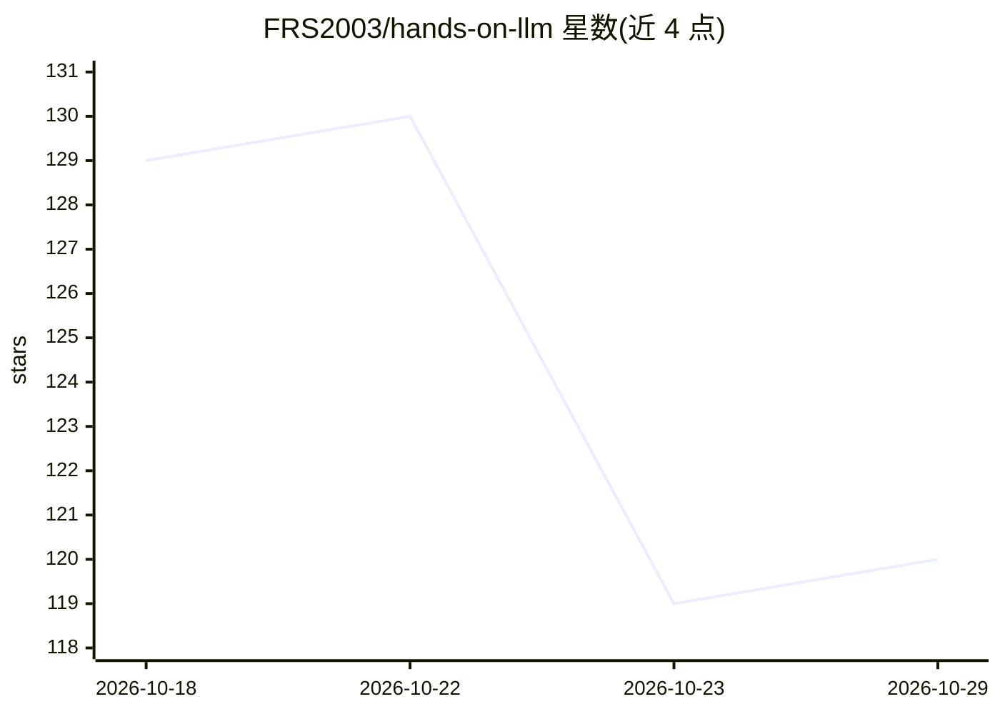

# FRS2003/hands-on-llm

⭐ 120 · Python · MIT · 推送 2026-09-16 · [GitHub](https://github.com/FRS2003/hands-on-llm) · 个人维护 · 中文 README

**大模型全栈自学实战仓库：从原理手搓到训练、Agent 与 RAG 落地**

面向学习者的 LLM 动手学习资料仓库：五模块路径覆盖 Stanford CS336 中文精讲、原生 PyTorch 手写 Transformer 组件与 Pretrain/SFT/LoRA/DPO/GRPO/RLVR 五阶段训练、LLaMA-Factory 源码走读与分布式实测、ReAct 编程 Agent、医学文献混合检索 RAG。全部实验在单张 RTX 3080 Ti 12GB 上跑通并留档日志/曲线；训练部分复现自 minimind，框架实验参考 LLaMA-Factory。Python 3.10 + PyTorch，Agent/RAG 走 OpenAI 兼容接口。

## 筛选速览

| 维度 | 判定 | 备注 |
|---|---|---|
| AI 角色 | `ai-knowledge` | 知识聚合/清单类 |
| 许可风险 | `permissive` | MIT |
| 部署形态 | `None` |  |
| 模型依赖 | — | README 未给出锁定关系 |
| 硬件要求 | — | 无带数字的原话,不猜 |
| 安装摩擦 | `low` | 无编译、无系统依赖或容器化 |
| 成熟度 | — | 结构信号不足 |

## 能力要点

- 单卡 12GB 跑通 Pretrain→SFT→LoRA→DPO→GRPO→RLVR 全链路并留存日志与曲线
- 原生 PyTorch + Triton 手写 BPE/RMSNorm/RoPE/GQA/SwiGLU 并配数值自检
- MHA/GQA/MQA × 混合精度架构消融与双卡 DDP/ZeRO 分布式对照实测
- 医学文献混合检索 RAG（BM25+稠密+Rerank+带引文生成）与 ReAct 编程 Agent

## 适用场景

- 系统自学大模型训练原理并亲手复现全链路
- 在消费级单卡上做对齐/RL 实验并对照结果
- 学习 LLaMA-Factory 工业框架与分布式训练实践

## 场景标签

`教程课程` · 领域:学习与行业

## 证据(README 行号)

> L8: > 一条**由理论到落地**的大模型自学与实战路径：先读透原理，再用原生 PyTorch 手搓并完整跑通
> L35: 收获：一套"**原理 → 手写 → 训练 → 框架 → Agent → 应用**"可运行、可复现、带真实数据的完整作品，而不是一堆零散 demo。
> L97: 本仓库为一套面向学习者的动手学习资料，训练部分复现自 jingyaogong/minimind（MIT）、

## 星数曲线

2026-10-18 129 → 2026-10-29 120（-9）

---
*卡片 v1 · prompt 1.4 · 生成 2026-10-22 · 置信度 high · 依据 README sha `77b7134435a9` · [字段定义](../../DATASET.md)*
