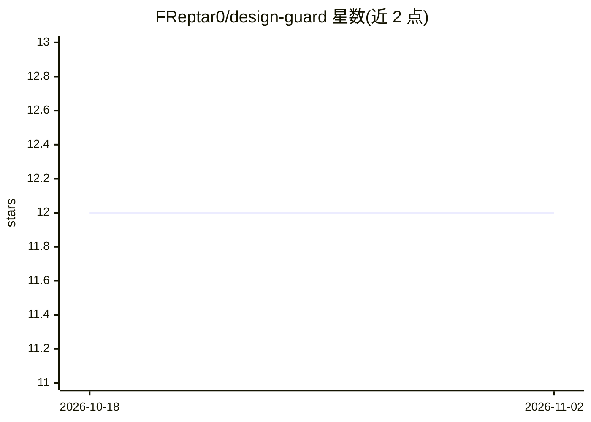

# FReptar0/design-guard

⭐ 12 · TypeScript · MIT · 推送 2026-04-14 · [GitHub](https://github.com/FReptar0/design-guard) · [官网](https://freptar0.github.io/design-guard/) · 个人维护

**面向 AI 网页设计的 CLI：研究业务、生成设计系统与页面并校验**

Design Guard 是一个 monorepo，含核心库 @design-guard/core 与 design-guard CLI（含 TUI 与 Claude Code 技能）。流程为：抓取并分析目标业务网站提取配色/排版/布局，生成 8 节的 DESIGN.md 设计系统，通过 Google Stitch MCP 或 Claude Direct 生成页面，再用 18 条 lint 规则（7 类）检测 AI 常见设计套路，最终导出静态 HTML、Astro 或 Next.js 站点。附 7 个 Claude Code 技能命令，核心库可独立调用，含 245 个测试。

## 筛选速览

| 维度 | 判定 | 备注 |
|---|---|---|
| AI 角色 | `ai-native` | 本体是模型或模型工具 |
| 许可风险 | `permissive` | MIT |
| 部署形态 | `library` | 以包/库形式分发 |
| 模型依赖 | — | README 未给出锁定关系 |
| 硬件要求 | — | 无带数字的原话,不猜 |
| 安装摩擦 | `low` | 无编译、无系统依赖或容器化 |
| 成熟度 | — | 结构信号不足 |

## 能力要点

- 抓取业务网站并推导定制化 DESIGN.md 设计系统
- 通过 Google Stitch MCP 或 Claude Direct 生成页面，带 prompt 护栏
- 18 条 lint 规则检测 AI 生成页面的常见设计套路
- 导出静态 HTML / Astro / Next.js，附 7 个 Claude Code 技能

## 适用场景

- 我想用 AI 生成落地页并用规则校验设计质量
- 从现有业务网站提炼一套可复用的设计系统
- 在 Claude Code 中通过技能命令完成设计到部署流程

## 场景标签

`网页抓取` `代码生成` · 领域:效率与自动化

## 证据(README 行号)

> L5:  Design Guard is a design intelligence engine and CLI for AI-generated web design.
> L36: 3. **Generate** screens — via Google Stitch MCP or Claude Direct, with prompt guardrails

## 星数曲线

2026-10-18 12 → 2026-11-02 12（+0）

---
*卡片 v1 · prompt 1.4 · 生成 2026-11-01 · 置信度 high · 依据 README sha `d1ecc078832d` · [字段定义](../../DATASET.md)*
