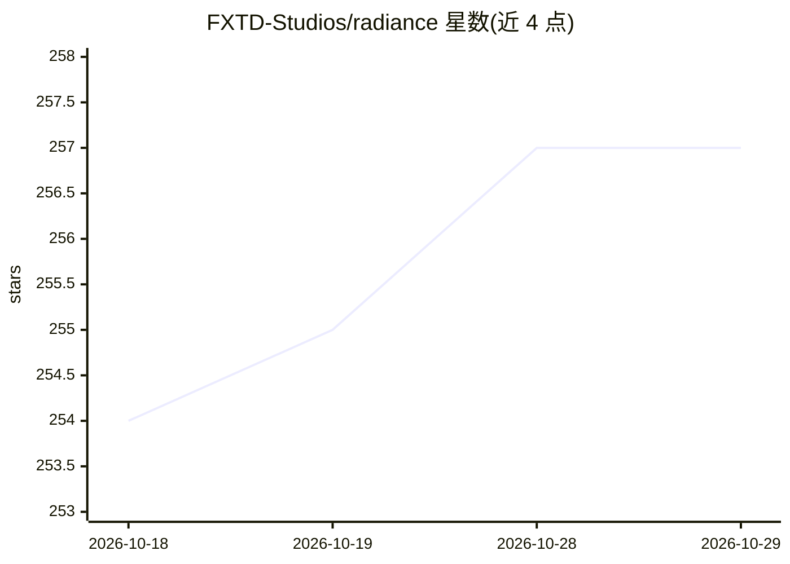

# FXTD-Studios/radiance

⭐ 257 · Python · GPL-3.0 · 推送 2026-10-28 · [GitHub](https://github.com/FXTD-Studios/radiance) · [官网](https://www.fxtdstudios.com) · 组织维护

**ComfyUI 的 HDR/色彩管理/VFX 节点集，含生成与审看工具**

面向 ComfyUI 的自定义节点集合，提供 147 个节点：HDR 图像处理（VAE 编解码、SDR→HDR 转换）、色彩管理（ACES、OpenColorIO、LUT、CDL）、图像/视频审看 Viewer（示波器、对比、播放）、VFX 遮罩/深度/重打光，以及读写节点用于交付到 Nuke 或 DaVinci Resolve。内置入门工作流支持 FLUX.2 Klein 4B 蒸馏模型生图，SDR→HDR 使用 Hugging Face 上的 RUDRA 模型（权重为非商业许可，与代码库 GPL-3.0 许可相互独立）。可经 ComfyUI Manager 或 git clone 手动安装。

## 筛选速览

| 维度 | 判定 | 备注 |
|---|---|---|
| AI 角色 | `ai-ecosystem` | LLM/agent 周边工具 |
| 许可风险 | `dual` | GPL-3.0 |
| 部署形态 | `desktop` | 安装包/桌面程序 |
| 模型依赖 | — | README 未给出锁定关系 |
| 硬件要求 | — | 无带数字的原话,不猜 |
| 安装摩擦 | `low` | 无编译、无系统依赖或容器化 |
| 成熟度 | — | 结构信号不足 |

## 能力要点

- 147 个可见节点覆盖 HDR、ACES/OpenColorIO 色彩管理、VFX 与文件交付
- Viewer 支持 Simple/Advanced 模式、示波器、对比与播放
- 内置 FLUX.2 Klein 4B 蒸馏模型生图入门工作流
- RUDRA 学习式 SDR→HDR 模型（默认首次使用时自动下载）

## 适用场景

- 在 ComfyUI 中把现有图像转为 HDR 并导出 EXR
- 对生成或实拍的图像视频做 ACES 色彩管理与调色
- 制作 VFX 镜头的遮罩、深度估计与多通道重打光
- 生成图像后在 Viewer 中审看并交付到 Nuke 或 DaVinci Resolve

## 场景标签

`图像视频处理` · 领域:感知与多模态

## 证据(README 行号)

> L4: **HDR, colour management, VFX tools, and image review inside ComfyUI.**
> L16: Radiance brings 147 visible nodes into your workflows for processing images and video, working with EXR and ACES, r
> L49: cd ComfyUI/custom_nodes

## 星数曲线

2026-10-18 254 → 2026-10-29 257（+3）

---
*卡片 v1 · prompt 1.4 · 生成 2026-10-22 · 置信度 high · 依据 README sha `1c2f7d4bad8a` · [字段定义](../../DATASET.md)*
