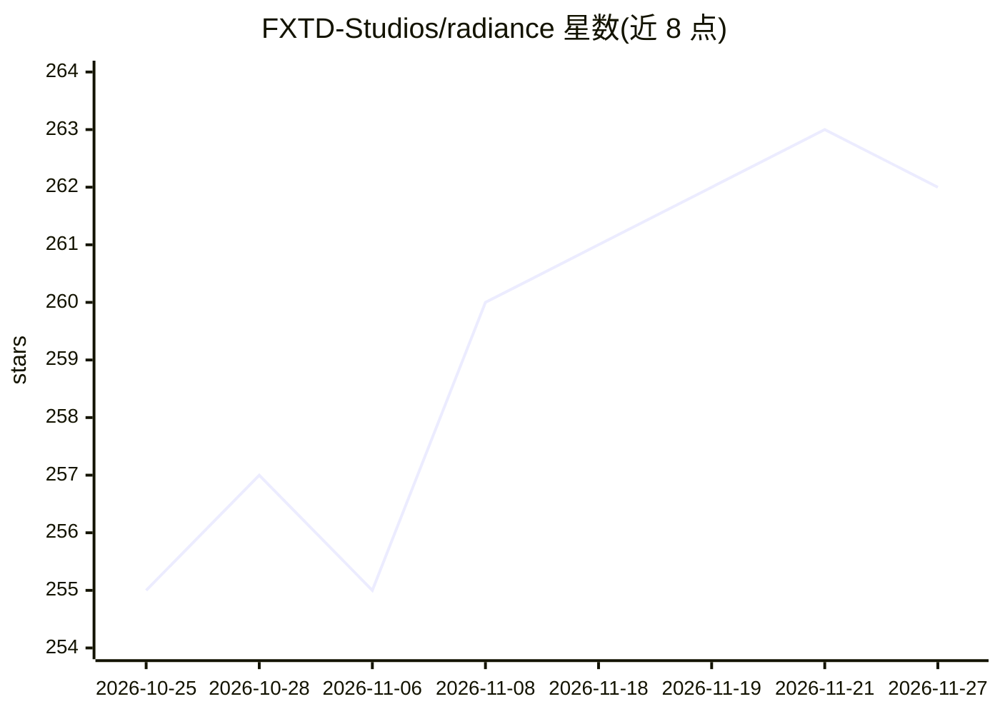

# FXTD-Studios/radiance

⭐ 262 · Python · Apache-2.0 · 推送 2026-11-25 · [GitHub](https://github.com/FXTD-Studios/radiance) · [官网](https://www.fxtdstudios.com) · 组织维护

**给 ComfyUI 加 HDR/色彩管理与 VFX 审片交付能力的节点套件**

面向使用 ComfyUI 的影像工作流：在 ComfyUI 内以 32-bit 精度生成、做 ACES 2.0 HDR 转换（含 SDR→HDR 的学习模型路线与无模型解析路线）、在专用 Viewer 中查看/对比/QC，并输出 EXR、HDR10/HDR10+、ProRes 母版对接 Nuke 与 DaVinci Resolve。含 40 个工作流模板（部分本地 GPU 运行，部分走 ComfyUI API 节点）、121 个节点。依赖 ComfyUI 本体；ffmpeg、OpenColorIO 2.5+ 为特定功能所需。

## 筛选速览

| 维度 | 判定 | 备注 |
|---|---|---|
| AI 角色 | `ai-enhanced` | 去掉 AI 部分产品仍成立 |
| 许可风险 | `permissive` | Apache-2.0 |
| 部署形态 | `desktop` | 安装包/桌面程序 |
| 模型依赖 | — | README 未给出锁定关系 |
| 硬件要求 | — | 无带数字的原话,不猜 |
| 安装摩擦 | `medium` | 含编译或系统依赖之一 |
| 成熟度 | — | 结构信号不足 |

## 能力要点

- SDR→HDR 双路线：RUDRA 学习模型（ACES 2）与无模型解析法（无需 GPU）
- 内置 Viewer：查看/对比/检查/调色、示波器与 Deliver Master 渲染队列
- 一键交付 EXR、HDR10/HDR10+ 与 ProRes 母版到 Nuke 和 Resolve
- 自动模型下载带固定版本与哈希校验，可用环境变量关闭

## 适用场景

- 在 ComfyUI 里生成 HDR 图像并输出 32-bit EXR 母版
- 把 SDR 照片或视频转成 ACES 2.0 HDR
- 调色、审片并在 Nuke/Resolve 间交付

## 场景标签

`图像生成` `图像视频处理` · 领域:内容生成

## 证据(README 行号)

> L20: Radiance adds HDR to ComfyUI: **generate** with FLUX 3 Klein, Qwen-Image, Wan and LTX, **turn SDR into HDR** with R
> L3: ### HDR, colour and VFX review for ComfyUI

## 星数曲线

2026-10-25 255 → 2026-11-27 262（+7）

---
*卡片 v1 · prompt 1.4 · 生成 2026-11-26 · 置信度 high · 依据 README sha `ca083b9111af` · [字段定义](../../DATASET.md)*
