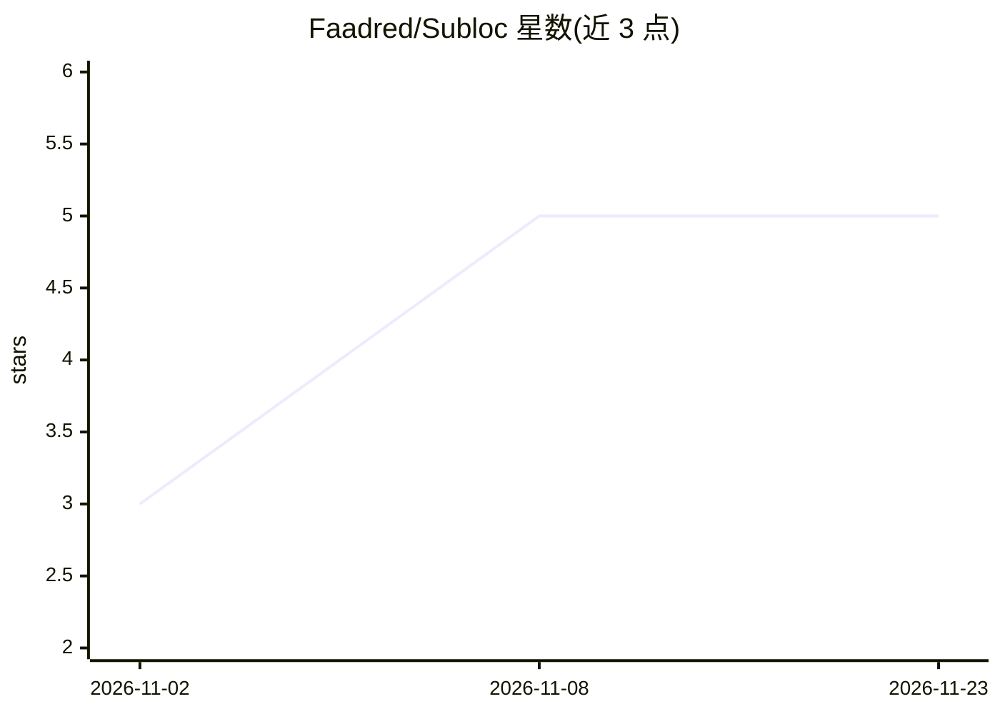

# Faadred/Subloc

⭐ 5 · Python · GPL-3.0 · 推送 2026-11-02 · [GitHub](https://github.com/Faadred/Subloc) · [官网](https://github.com/Faadred/Subloc) · 个人维护

**为阿拉伯语观众在本地生成并翻译任意视频字幕**

Windows 桌面应用（PySide6），拖入视频后本地完成字幕制作：ffmpeg 抽取音频，Whisper 转写并标注说话人及性别，本地 LLM（llama.cpp + GGUF 模型）按整幕场景翻译，针对阿拉伯语性别变形（阳性/阴性/复数 you）定向处理，支持利用已有内嵌字幕、二次识别耳语音量、逐行人工校正、字幕样式与硬字幕导出。全部处理在本机进行，网络流量限于模型下载与更新检查。也提供 CLI 与 MCP 服务器供 AI agent 调用。

## 筛选速览

| 维度 | 判定 | 备注 |
|---|---|---|
| AI 角色 | `ai-native` | 本体是模型或模型工具 |
| 许可风险 | `viral` | GPL-3.0 |
| 部署形态 | `desktop` | 安装包/桌面程序 |
| 模型依赖 | local-ok | 支持本地模型 |
| 硬件要求 | — | 无带数字的原话,不猜 |
| 安装摩擦 | `medium` | 含编译或系统依赖之一 |
| 成熟度 | `idea` | |

## 能力要点

- Whisper 转写 + 本地 LLM 按场景上下文翻译，统一人名拼写
- 识别说话人性别，正确输出阿拉伯语阳性/阴性/复数形式
- 支持接入自配服务器：LM Studio、Ollama 或任意 OpenAI 兼容地址
- CLI 全功能覆盖，并可作 MCP 服务器供 Claude Desktop/Code 调用

## 适用场景

- 为无字幕的剧集/电影/动画本地生成阿拉伯语字幕
- 把已有英文字幕直接翻译成 17 种语言
- 在隐私敏感环境下离线处理视频字幕
- 通过 AI agent 批量查找并补齐缺失字幕的视频

## 场景标签

`语音识别` · 领域:感知与多模态

## 证据(README 行号)

> L45: **Subtitles for any video, made on your own PC.** Drop in a movie, a series episode or an anime, and get
> L58: - **Listens and writes** — Whisper turns the speech into timed text, on your graphics card.
> L59: - **Translates with context** — a local language model translates whole scenes, not single lines, keeps
> L92: video ─► ffmpeg ─► Whisper (speech → timed lines, quiet parts heard twice) ─┐

## 星数曲线

2026-11-02 3 → 2026-11-23 5（+2）

---
*卡片 v1 · prompt 1.4 · 生成 2026-11-21 · 置信度 high · 依据 README sha `8ee00c9e8180` · [字段定义](../../DATASET.md)*
