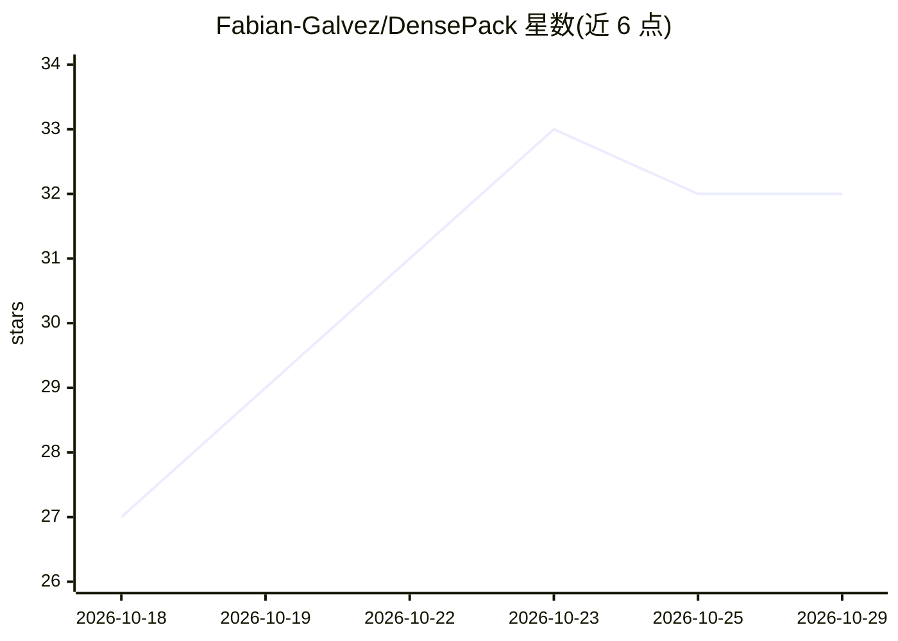

# Fabian-Galvez/DensePack

⭐ 32 · Python · MIT · 推送 2026-10-27 · [GitHub](https://github.com/Fabian-Galvez/DensePack) · [官网](https://fabian-galvez.github.io/DensePack/) · 个人维护

**把文本打包成图像供 Claude Code 阅读、降低 token 消耗的插件**

Claude Code 插件，配合右键工具与 HTML 应用：将文本文件与 Bash 输出用 FreeType 渲染为图像，模型按 28×28 像素块计费，使同样文本约占一半输入 token，降低整个会话价格（基准显示 45.0%–70.8%）。提供斜杠命令控制行为，并带误读防护（随机 ID 等以精确文本随图发送、Edit 前校验）。要求 Python 3.10+ 与 Bash；中文/日文/韩文等缺字形文本不转换，Haiku 模型仍走文本。数据不外发。

## 筛选速览

| 维度 | 判定 | 备注 |
|---|---|---|
| AI 角色 | `ai-ecosystem` | LLM/agent 周边工具 |
| 许可风险 | `permissive` | MIT |
| 部署形态 | `None` |  |
| 模型依赖 | — | README 未给出锁定关系 |
| 硬件要求 | — | 无带数字的原话,不猜 |
| 安装摩擦 | `low` | 无编译、无系统依赖或容器化 |
| 成熟度 | `idea` | |

## 能力要点

- 文本与 Bash 输出打包为图像，图像 token 约为文本一半
- 斜杠命令体系（/densepack、/maxpack、/densetext 等）
- 误读防护：随机 ID/长数字旁附精确文本，Edit 前校验阻止错误修改
- 无数据外发，仅联网安装 Python 及依赖库

## 适用场景

- 降低 Claude Code 长会话的 API 费用
- 大量读文件/读代码的会话中减少 token 消耗
- 配合 Sonnet 子代理进一步压低读取成本

## 场景标签

 · 领域:LLM 基础设施/开发者工具

## 证据(README 行号)

> L3:  DensePack cuts the price of whole Claude Code sessions by 45.0% to 52.8% with Opus 5.5, and 58.9% to 70.8% with a S
> L63: ## Install the plugin
> L74: DensePack saves by packing what the agent reads and the output of its commands into images. Bash output packs whole

## 星数曲线

2026-10-18 27 → 2026-10-29 32（+5）

---
*卡片 v1 · prompt 1.4 · 生成 2026-10-26 · 置信度 high · 依据 README sha `68a44c4621d5` · [字段定义](../../DATASET.md)*
