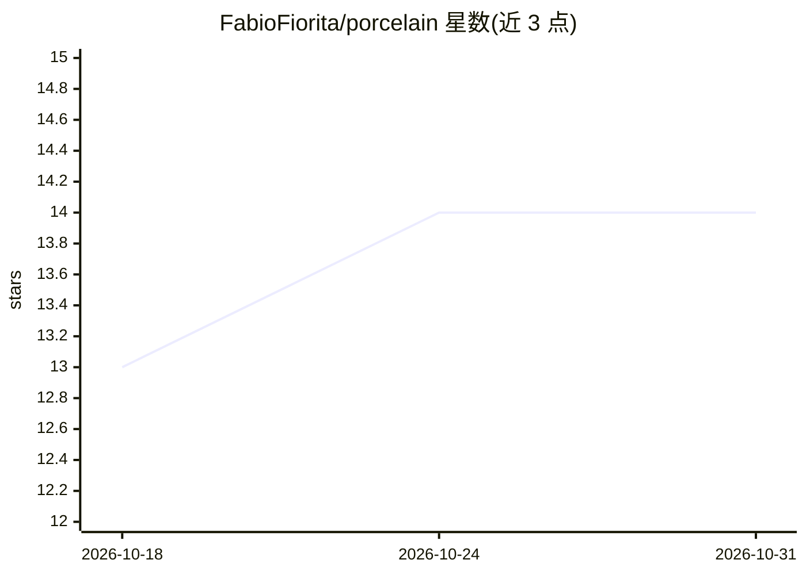

# FabioFiorita/porcelain

⭐ 14 · TypeScript · MIT · 推送 2026-10-30 · [GitHub](https://github.com/FabioFiorita/porcelain) · [官网](https://porcelain.fabiofiorita.com) · 个人维护

**审阅编码 agent 改动的桌面/Web 工具：按决策走查 diff 并回复评论**

面向使用编码 agent 的开发者：不运行 agent，而是与其并排工作，通过 MCP 协议让 agent 发布逐项决策简报，用户按停靠点阅读 diff，可就文件或行评论，agent 在同一线程回答。未解释的改动有独立停靠点，检查运行结果与截图保留在审阅中，并标注代码事后变更。支持大仓库（置顶/隐藏文件、commit 图浏览、推拉操作），可在每台存仓库的机器上跑 server，从一处访问全部。提供 Mac 应用（Apple silicon）与 npx 运行的服务器+浏览器模式；无账户、不上传代码。iPhone/iPad 版标注即将推出。

## 筛选速览

| 维度 | 判定 | 备注 |
|---|---|---|
| AI 角色 | `ai-ecosystem` | LLM/agent 周边工具 |
| 许可风险 | `permissive` | MIT |
| 部署形态 | `library` | 以包/库形式分发 |
| 模型依赖 | — | README 未给出锁定关系 |
| 硬件要求 | — | 无带数字的原话,不猜 |
| 安装摩擦 | `low` | 无编译、无系统依赖或容器化 |
| 成熟度 | — | 结构信号不足 |

## 能力要点

- 通过 MCP 让 agent 发布逐决策审阅简报，用户评论、agent 同线程回复
- 未解释的改动单独设停靠点，reviewed 标记统计剩余项
- 审阅中保留 agent 跑的检查与截图，并检测其后代码是否再变
- 多机各跑 server、单一入口访问所有仓库

## 适用场景

- 让编码 agent 交付后按顺序走查每个改动再决定保留
- 在文件或行级别向 agent 提问并跟踪回复
- 在本地/内网环境下不外传代码地审阅 agent 工作

## 场景标签

`代码审查` · 领域:编码与开发

## 证据(README 行号)

> L13: I started building my own agent harness and then watched T3 Code do it better than I could. So Porcelain does not r
> L21: - **Comment back.** Ask on a file or a line. The agent answers in the same thread over MCP.
> L50: Porcelain talks to agents over MCP. Add it to your agent's MCP configuration and start the agent from a repository 

## 星数曲线

2026-10-18 13 → 2026-10-31 14（+1）

---
*卡片 v1 · prompt 1.4 · 生成 2026-10-31 · 置信度 high · 依据 README sha `ec44ce412116` · [字段定义](../../DATASET.md)*
