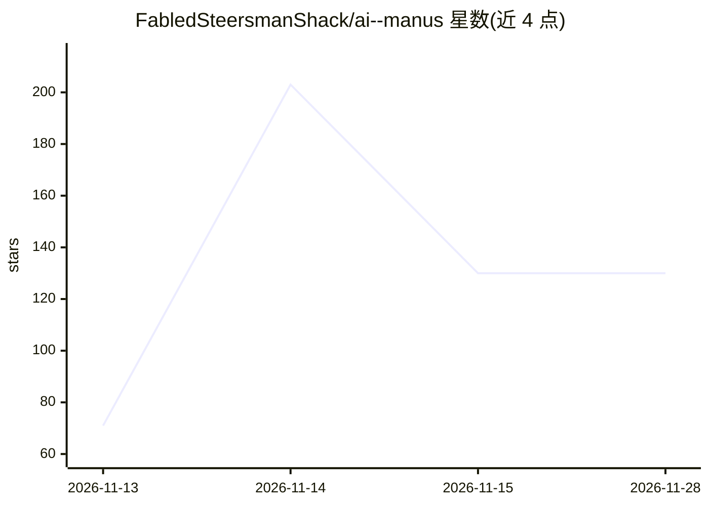

# FabledSteersmanShack/ai--manus

⭐ 130 · Apache-2.0 · 推送 2026-11-15 · [GitHub](https://github.com/FabledSteersmanShack/ai--manus) · 个人维护

**自主执行代码与浏览器操作的通用 AI Agent 系统**

面向家庭、学习与轻量办公场景的自主 AI 代理：接收自然语言指令后自行编写并执行脚本、打开网页、填写表单、跨页面收集信息，完成多步骤任务。定位为无需编程背景的个人助手，非企业平台。README 给出最低双核 CPU、4 GB 内存的兼容性表，并描述准备、配置、测试、优化的上手流程，但未提供具体的安装命令或依赖说明。

## 筛选速览

| 维度 | 判定 | 备注 |
|---|---|---|
| AI 角色 | `ai-native` | 本体是模型或模型工具 |
| 许可风险 | `permissive` | Apache-2.0 |
| 部署形态 | `None` |  |
| 模型依赖 | — | README 未给出锁定关系 |
| 硬件要求 | — | 无带数字的原话,不猜 |
| 安装摩擦 | `low` | 无编译、无系统依赖或容器化 |
| 成熟度 | — | 结构信号不足 |

## 能力要点

- 自主编写并执行代码完成任务
- 代理式浏览器控制：导航、填表、收集信息
- 代码与浏览器动作在同一任务流中衔接
- 面向家庭、学习与轻量办公的小规模场景设计

## 适用场景

- 让代理代为完成跨网页的数据收集与整理
- 自动运行小脚本并比较结果
- 把重复性日常任务委托给后台个人助手

## 场景标签

`AI 助手` `浏览器自动化` `代码生成` · 领域:效率与自动化

## 证据(README 行号)

> L18: Manus is an autonomous AI agent designed to run code and control a browser on your behalf. Instead of acting like a
> L22: Manus is not a heavy studio suite or a complex enterprise platform. It is a focused helper built for home, study, a

## 星数曲线

2026-11-13 71 → 2026-11-28 130（+59）

---
*卡片 v1 · prompt 1.4 · 生成 2026-11-17 · 置信度 mid · 依据 README sha `a3d88e202bf0` · [字段定义](../../DATASET.md)*
