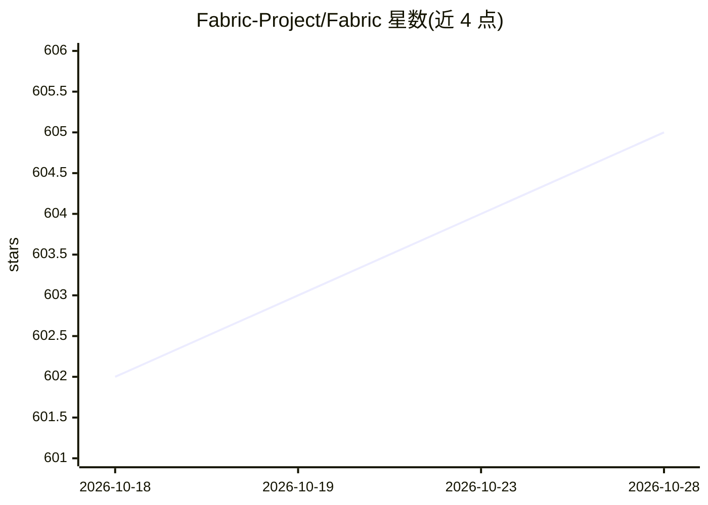

# Fabric-Project/Fabric

⭐ 605 · Swift · BSD-3-Clause · 推送 2026-10-28 · [GitHub](https://github.com/Fabric-Project/Fabric) · [官网](https://fabric.graphics) · 个人维护

**macOS 节点式创意编程环境，用于交互视觉与 3D 创作**

受 Apple 已停用的 Quartz Composer 启发的节点式可视化创作工具，面向交互视觉、图像/视频处理分析与 3D 内容创作。提供可视化节点编辑环境、通用交换文件格式 SDK 与插件式自定义节点 SDK；基于 Satin 渲染引擎与 Lygia 着色器库，支持 PBR、实时着色器热重载、GPU 计算等，并包含 ML 实时分割/关键点检测与本地 LLM 调用节点。仅限 macOS 15+，提供签名应用下载，开发者需从源码（含子模块）自行构建。项目声明仍在建设中。

## 筛选速览

| 维度 | 判定 | 备注 |
|---|---|---|
| AI 角色 | `ai-enhanced` | 去掉 AI 部分产品仍成立 |
| 许可风险 | `permissive` | BSD-3-Clause |
| 部署形态 | `None` |  |
| 模型依赖 | — | README 未给出锁定关系 |
| 硬件要求 | — | 无带数字的原话,不猜 |
| 安装摩擦 | `low` | 无编译、无系统依赖或容器化 |
| 成熟度 | `idea` | |

## 能力要点

- 可视化节点创作环境与插件式自定义节点 SDK
- 基于 Satin/Lygia 的 PBR、实时 shader 热重载、GPU Compute 渲染能力
- ML 实时分割与关键点检测、本地 LLM 调用节点
- 可嵌入第三方应用的文档运行时加载机制

## 适用场景

- 零编程或低编程经验用户创作交互式 3D 与视觉内容
- 搭建音频反应场景与图像/视频处理分析管线
- 将创作文档嵌入自己的应用中复用

## 场景标签

`图像视频处理` · 领域:感知与多模态

## 证据(README 行号)

> L8: Fabric is a creative code and rapid prototyping environment focusing on interactive visuals, image and video process
> L49: - ML based realtime segmentation and keypoint detection
> L51: - Local LLM calling

## 星数曲线

2026-10-18 602 → 2026-10-28 605（+3）

---
*卡片 v1 · prompt 1.4 · 生成 2026-10-22 · 置信度 high · 依据 README sha `f749d3694770` · [字段定义](../../DATASET.md)*
