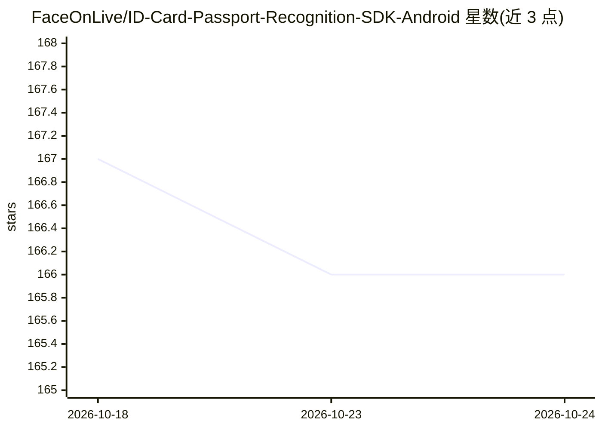

# FaceOnLive/ID-Card-Passport-Recognition-SDK-Android

⭐ 166 · Kotlin · 推送 2026-07-02 · [GitHub](https://github.com/FaceOnLive/ID-Card-Passport-Recognition-SDK-Android) · [官网](https://faceonlive.com) · 组织维护

**Android 端设备内证件识别 SDK：护照/身份证/驾照 OCR 与 MRZ**

FaceOnLive 面向 Android 的证件识别 SDK，在设备本地完成护照、身份证、驾照的文字字段、MRZ 与人像照片提取，全程离线无网络调用，输出结构化 JSON（证件类型、持有人信息、裁剪图像）。支持相机实时帧与相册图片输入，最低 Android 7.0，以 Kotlin/Java API 形式提供，需在 faceonlive.com 获取许可证密钥激活；仓库仅含演示源码，完整引擎库与模型需从 Releases 下载。

## 筛选速览

| 维度 | 判定 | 备注 |
|---|---|---|
| AI 角色 | `ai-native` | 本体是模型或模型工具 |
| 许可风险 | `none` | — |
| 部署形态 | `desktop` | 安装包/桌面程序 |
| 模型依赖 | — | README 未给出锁定关系 |
| 硬件要求 | — | 无带数字的原话,不猜 |
| 安装摩擦 | `low` | 无编译、无系统依赖或容器化 |
| 成熟度 | — | 结构信号不足 |

## 能力要点

- 设备本地离线识别护照/身份证/驾照，无网络调用
- 提取文字字段、MRZ 与人像照片，输出结构化 JSON
- 支持相机实时帧（YUV 转 Bitmap）与相册图片输入
- 提供 Kotlin/Java API：激活、初始化、识别等接口

## 适用场景

- 在 Android 应用中集成证件扫描与信息录入
- eKYC/KYC 场景中本地提取证件信息不上传原始图像
- 实时相机取流识别证件并获取 MRZ 数据

## 场景标签

`OCR` · 领域:感知与多模态

## 证据(README 行号)

> L3: On-device ID document recognition (MRZ, OCR, and portrait extraction) for Android. Scan passports, national ID cards
> L9: - **ID document recognition** — extract text fields, MRZ, and the portrait photo from an ID.
> L10: - **On-device & offline** — all processing runs locally; no network calls, no cloud.

## 星数曲线

2026-10-18 167 → 2026-10-24 166（-1）

---
*卡片 v1 · prompt 1.4 · 生成 2026-10-22 · 置信度 high · 依据 README sha `ca3961ab4ab3` · [字段定义](../../DATASET.md)*
